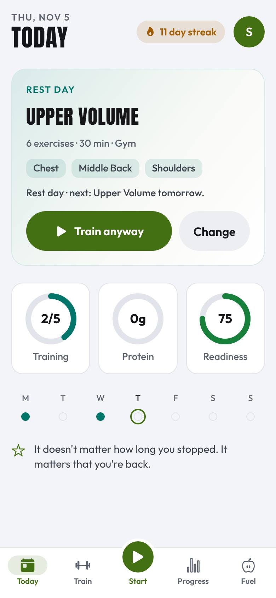
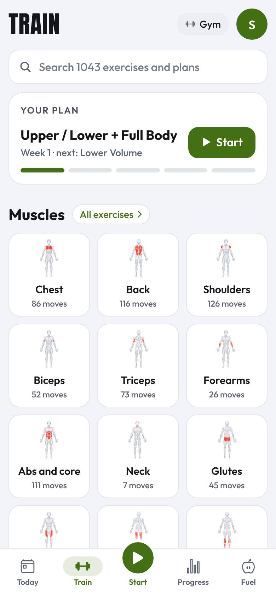
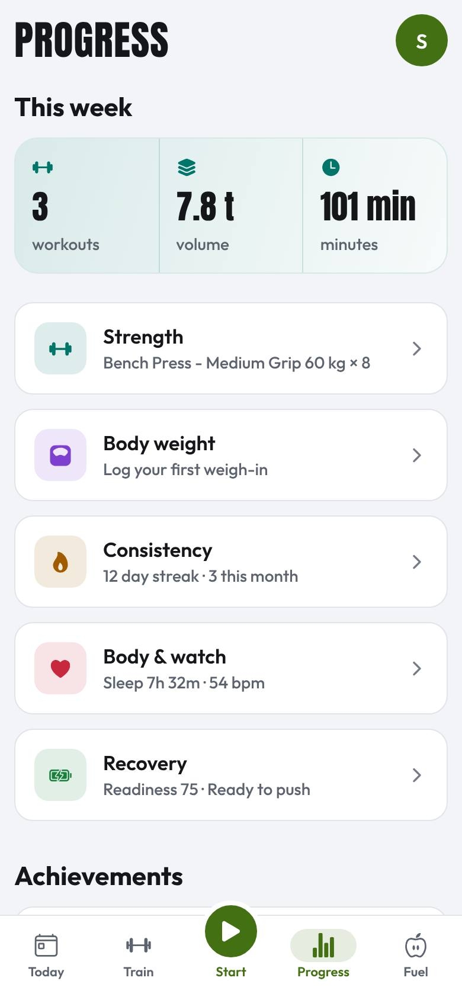
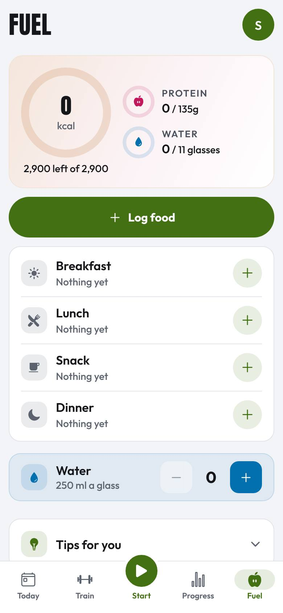

# Gym Buddy guide

How the app works, screen by screen: what each part is for, how people move through it, where every number comes
from, and how to connect a watch. Screenshots are from the web build at phone size (light theme unless marked).

Keep this guide current: when a screen, flow, data source or connection changes, update the page here and retake its
screenshot (`docs/guide/img/`, 390 × 844, JPEG).

| Page | What it covers |
|---|---|
| [Journeys](journeys.md) | First setup, a normal training day, a rest day, logging food, connecting a watch, checking recovery |
| [Features](features.md) | Every screen and control, what it does and why it's built that way |
| [Connect your watch](connect-devices.md) | Fitbit / Pixel Watch, WHOOP, Samsung, Garmin, Oura and others, step by step; live heart rate over Bluetooth; file import; smart rings |
| [Data and sources](data-sources.md) | Where each number comes from, how scores are worked out, what is stored and where, credits and licences |

## The app at a glance

Five tabs at the bottom, a centre button, and your profile behind the round avatar at the top right of every tab.

| Place | For |
|---|---|
| **Today** | What to do today: the next workout, three rings (training, food, readiness or sleep), the week |
| **Train** | Your plan, every exercise, search, other plans |
| **Start** (centre) | Opens today's workout. Reads **Resume** with the time while one is running |
| **Progress** | Training minutes, strength, body, recovery, badges, history |
| **Fuel** | Log food and water, today's totals, food tips |
| **You** (avatar) | Your watch, recovery, theme and colours, plan and goal, about you, reminders, your data |

Rules every screen follows: at most two levels deep (a tab, then one page), actions open as sheets from the bottom,
one main button per screen, Back always goes where you came from.

