# Connect your watch

Where to go: **Today › Tracker pane › Connect a watch**, the **Connect a watch** row on Today's Get started card, or
**You › Watch & health › Connect a watch**. Everything here needs the Android app; the web preview shows the steps
("Connecting needs the Android app. Here you can read the steps") with the buttons switched off.

## How the connect flow works

1. **Pick your watch.** A small diagram shows how data travels: your watch → its own app → Health Connect → Gym Buddy,
   with one sentence: watches don't pair with Gym Buddy directly. Eight tiles (Fitbit / Pixel, WHOOP, Samsung Galaxy,
   Garmin, Amazfit / Zepp, Xiaomi / Mi Band, Colmi ring, Other or a strap) plus chips for Oura, Huawei and Polar.
2. **Your brand's page.** A status line ("Last data today from Fitbit · synced 14 min ago", or "Not connected yet"),
   the brand's own data path with a tick on each hop we've seen working, and a plain sentence on why it goes that way.
3. **Three numbered steps, one button each.** **Get the app** (opens its Play Store page, which says Open when it's
   installed) → **Turn on Health Connect in it** (the menu path on one line; **Show every tap** for the full list) →
   **Allow Gym Buddy to read it** (Allow access: turn on all, then Allow). The current step's button is the filled one;
   done steps get a tick. Access is asked for the last 30 days; **Allow older history** is a separate, optional step.
4. **After access**: "Data is arriving from Fitbit. See what below" and Done, or "Nothing from WHOOP yet" with the fix
   (open the brand's app once so it syncs) and **Check again**.
5. **What Gym Buddy gets**: every metric with its state: ✓ received this week, ○ usually shared but not here yet,
   ? depends on plan or model, ⊖ we can't read it yet, plus a line naming what the brand never sends.
6. **Live heart rate in workouts** for brands that can broadcast: its own Bluetooth diagram, the steps on the watch,
   and **Find my watch**.

Once connected, **Tracker** shows all of it (live heart rate, today's numbers, heart rate today, the watch's workouts),
**Watch & health** shows the status card with **Sync now**, and the **Calendar** shows watch days and calories.

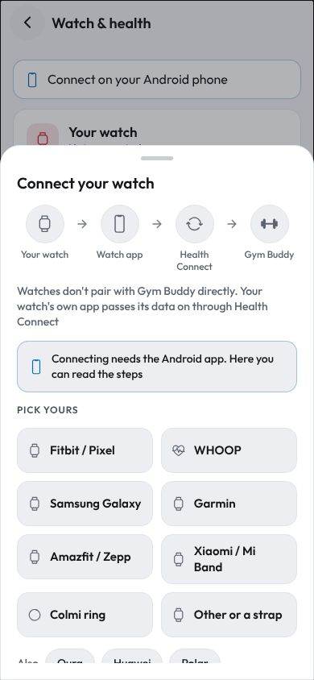
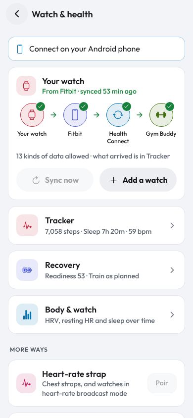
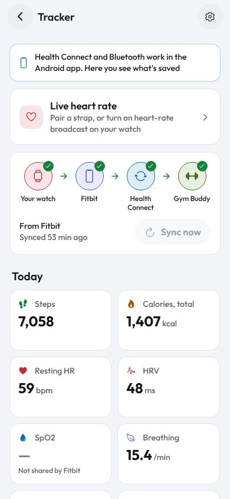

## Why there is no "pair with Fitbit" button

Fitbit, WHOOP, Samsung, Garmin and Oura watches pair only with their own app, using encrypted keys we can't use. Their
data reaches other apps in one of two ways, and the app uses both:

1. **Daily data through Health Connect.** Your watch's app (Google Health for Fitbit, WHOOP, Samsung Health, Garmin
   Connect…) writes steps, sleep, heart rate and more into Android's Health Connect. You allow our app to read it once.
   This is how Google itself recommends sharing Fitbit data now.
2. **Live heart rate over Bluetooth during workouts.** Some devices can broadcast heart rate like a chest strap. You
   turn broadcast on, on the device, and our app finds it. This is a real Bluetooth pairing and works mid-workout.

Cloud sign-in is not offered (checked November 2026):
- The **Fitbit Web API** was switched off on 2 November 2026 (it now returns HTTP 410). Its successor, the
  **Google Health API**, has only restricted scopes: past 100 users it needs a yearly paid security assessment, test
  users' tokens expire every 7 days, and it is documented only for apps with their own server. Sources:
  [about](https://developers.google.com/health/about), [setup](https://developers.google.com/health/setup),
  [app verification](https://developers.google.com/health/app-verification).
- The **WHOOP developer API** needs a client secret kept on a server and is limited to 10 members while in
  development ([WHOOP OAuth docs](https://developer.whoop.com/docs/developing/oauth)).

## Fitbit and Pixel Watch

The Fitbit app is now called **Google Health** (same app, renamed 19 May 2026).

**1. Daily data** (all Fitbit trackers and Pixel Watches)

In Google Health:
1. Open Google Health
2. Tap **Connections** at the top left
3. Tap **Partner apps**
4. Tap **Sync your favorite health apps**, then **Set up**
5. Tap **Accept**, pick your data, tap **Continue**
6. Tap **Allow all**, then **Allow**, then **Done**

Then in our app: step 3, **Allow access**, turn on everything, tap **Allow**. The page then says "Data is arriving from
Fitbit". If nothing came yet: open Google Health once so it syncs, then **Check again**.

Shares: steps, distance, calories, sleep with stages, heart rate, resting heart rate, HRV, breathing rate, VO2 max,
weight, workouts, and skin temperature (which we can't read yet). It does **not** write SpO2 to Health Connect, so
Tracker shows "Not shared by Fitbit" there. Source: [Google Health help 14506680](https://support.google.com/googlehealth/answer/14506680).

Naming: the app is called Google Health, but people know the watch as a Fitbit. Where a number's source is named
(Tracker, Watch & health, Calendar) the app says **Fitbit**; where you must find the app (Get / Open buttons, "Turn on
Health Connect in…") it says **Google Health**.

**2. Live heart rate in workouts** (Charge 6, Edge, Fitbit Air, Pixel Watch 2 and newer)

- *Charge 6 or Edge*: swipe down from the clock face › **Broadcast HR**; in our app tap **Find my watch** and pick it;
  on the watch tap **Share**, then **Start**. One connection at a time.
- *Pixel Watch 2 or newer*: swipe down › **Connected Fitness** › **Connect**, then accept the pairing request on the
  phone. Pixel Watch 3 and newer allow two connections.
- Older Fitbits (Charge 5, Versa, Sense, Inspire) can't broadcast; daily data still works.

Source: [Google Health help 14236705](https://support.google.com/googlehealth/answer/14236705).

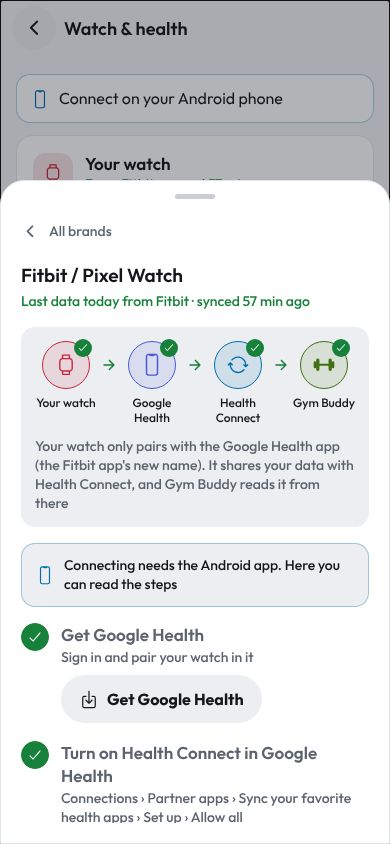
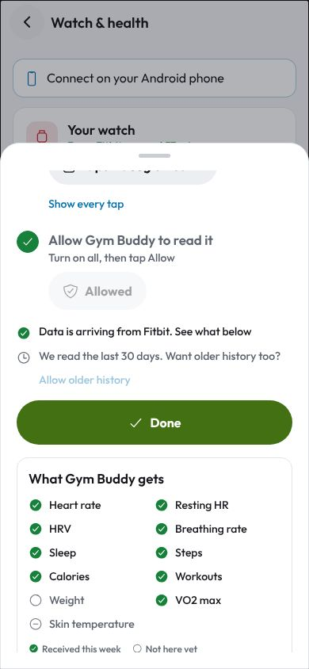
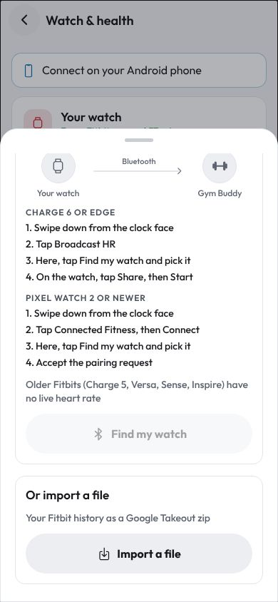

## WHOOP

**1. Daily data**

In WHOOP:
1. Open WHOOP
2. Tap **More** at the bottom right
3. Tap **Account & Settings**, then **Integrations**
4. Tap **Health Connect**, then **Set Up**
5. Tap **Allow all**, then **Allow**

Then **Allow access** in our app, as above.

Shares: sleep, workouts, calories, body metrics, and resting heart rate and breathing rate on plans with Health Monitor.
Steps and SpO2 are marked **"depends on plan or model"**: sources disagree (WHOOP has no step sensor) until tested on a
real account. WHOOP **never** shares heart-rate samples, HRV, VO2 max, recovery or strain, so the WHOOP page says
"WHOOP doesn't send heart rate, HRV and VO2 max". Our readiness uses HRV from live heart rate in workouts when the
broadcast includes beat-to-beat intervals. Sources: WHOOP support's Health Connect article (tiers) and
[ultrafit360, Oct 2026](https://ultrafit360.com/blog/whoop-apple-health-health-connect) (secondary).

**2. Live heart rate in workouts** (WHOOP 4.0, 5.0, MG)

1. In WHOOP, tap your strap icon for **Device settings**
2. Turn on **Broadcast Heart Rate**
3. In our app, tap **Find my WHOOP** and pick it

It shares with one app at a time. The strap is remembered and reconnects when a workout starts. Confirmed on 4.0 and
5.0 ([community, 2025](https://www.community.whoop.com/t/real-time-heart-rate-and-milestone-broadcast-not-working/7258),
[WHOOP Locker](https://www.whoop.com/thelocker/10-whoop-features-you-need-to-know/)); MG unconfirmed.

We don't use WHOOP's own Bluetooth protocol: WHOOP's terms forbid reverse engineering it.

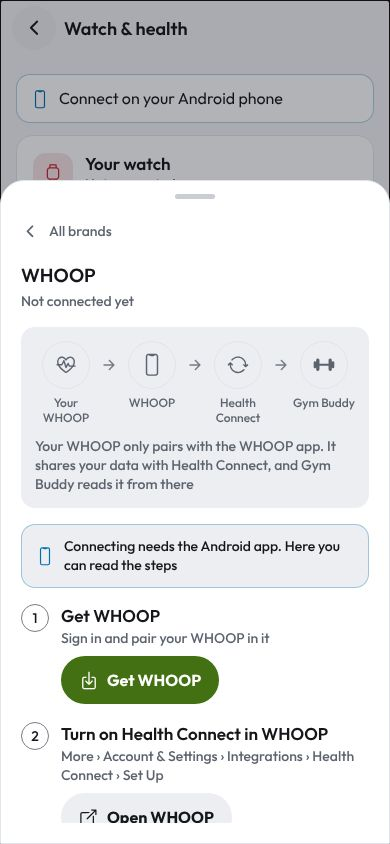
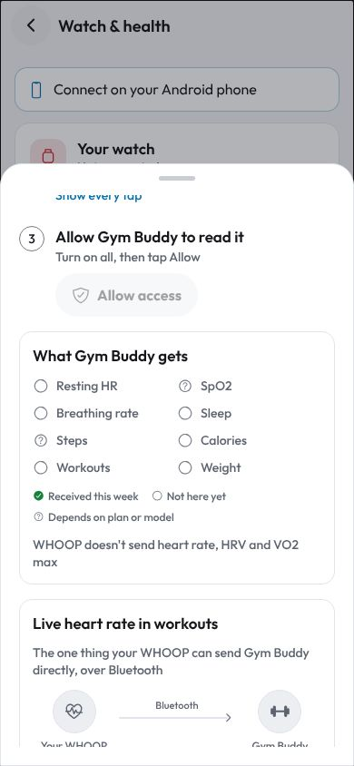
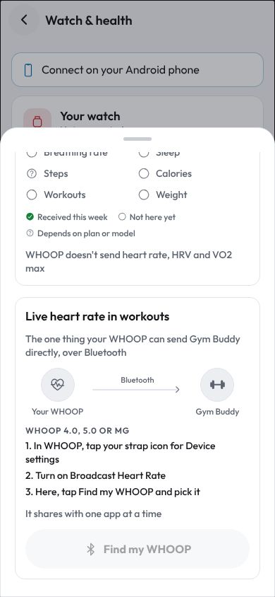

## Other brands

| Brand | Daily data path (in the brand's app) | Notes |
|---|---|---|
| Samsung Galaxy Watch | Samsung Health › Settings › Health Connect › Get started › pick data › Allow | [Samsung developer blog](https://developer.samsung.com/health/blog/en/accessing-samsung-health-data-through-health-connect) |
| Garmin | Garmin Connect › More › Settings › Connected apps › Health Connect › Allow all | Needs Connect 5.14+; only new data is shared |
| Oura | Menu › Settings › Data sharing › Health Connect › turn on | [Oura support](https://support.ouraring.com/hc/en-us/articles/10786105824531) |
| Amazfit / Zepp | Profile › 3rd-party account linking › Health Connect | Gadgetbridge is an alternative |
| Xiaomi / Mi Fitness | Profile › Third-party data › Health Connect › Connect | Shares only while Mi Fitness is open |
| Huawei | No Health Connect support | Use Gadgetbridge, or live heart rate: watch Settings › HR Data Broadcasts |
| Polar / Wahoo / chest strap | Polar Flow › General settings › Health Connect on | Straps: **Heart-rate strap** card, standard Bluetooth heart rate (0x180D), HRV from RR intervals |
| Colmi / Yawell ring | — | Its own two-step page (charge the ring, then **Go to ring card**): our own Bluetooth adapter (R02–R12, V1 and V2 protocols), heart rate, SpO2, steps, calories |
| Gadgetbridge | Settings › External integrations › Health Connect › Enable export › Select devices › Sync after device sync | Open-source app for many watches; [guide](https://gadgetbridge.org/basics/integrations/health-connect/) |

The brand steps, menu paths and "usually shares" lists live in `src/health/guides.ts`; menu names drift with app
updates, so fix them there. The lists for Samsung, Garmin, Zepp, Mi Fitness, Polar and Oura come from secondary sources;
the ticks on each page come only from data that really arrived.

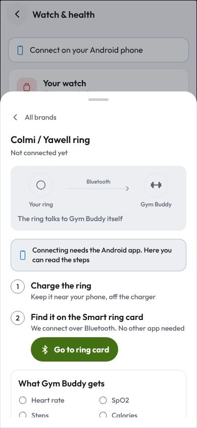
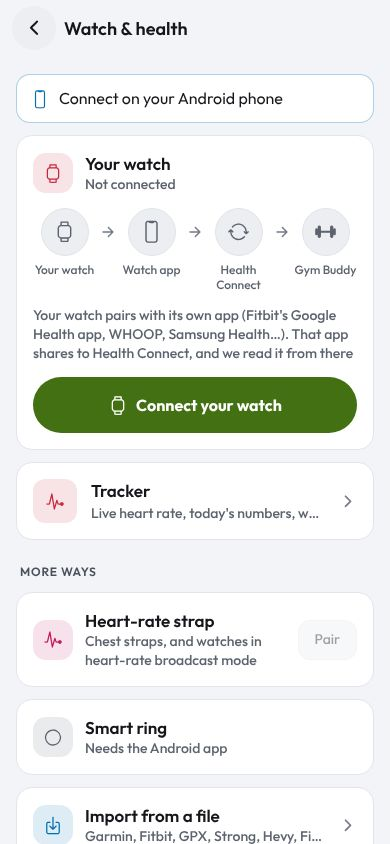
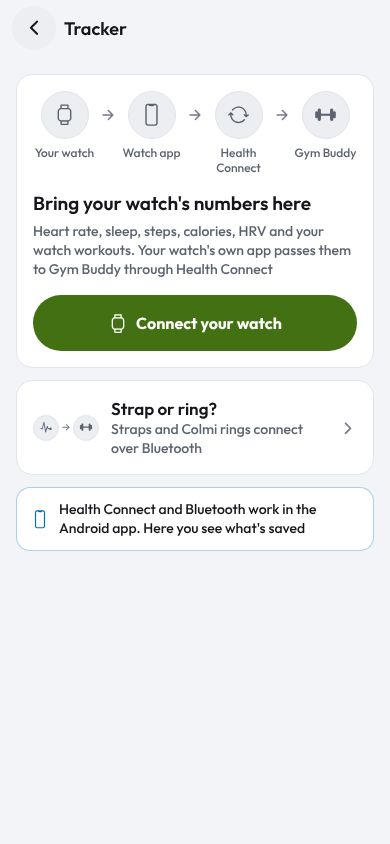

## Import from a file

**Watch & health › More ways › Import from a file** reads: Garmin/Wahoo/any `.fit` file (our own decoder), Fitbit Google Takeout
(`.zip` or its JSON/CSV), Garmin export, `.gpx` and `.tcx` routes, and Strong, Hevy and FitNotes workout exports
(`.csv`). Imported workouts are marked with their source and merged with matching ones.

## What happens after connecting

- Sync runs when the app opens and comes back to the front, and with **Sync now** (Tracker, Watch & health).
- **Tracker** shows today's numbers, heart rate today in 10-minute steps and the watch's workouts; the **Calendar** marks
  watch days and counts their calories once; **Recovery** starts once 4 nights have arrived.
- Workouts you finish are written back to Health Connect (with notes), so your watch's app sees them too.
  **Disconnect** can also remove what we wrote.
- During a workout the header shows live bpm; each set keeps its heart rate.

## Needs a real phone to confirm

Nothing in the connect flow could be tested on the web build. Still to confirm on a phone: the permission dialog and
the separate older-history step, the data check, the new today's-heart-rate and watch-workout kcal reads, Bluetooth scans for Charge 6 / Pixel Watch / WHOOP 5.0 and MG, whether WHOOP's
broadcast includes beat-to-beat intervals, and how long Google Health and WHOOP take to sync into Health Connect.
