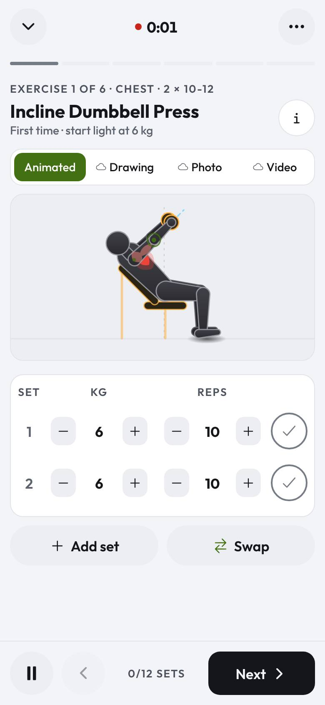
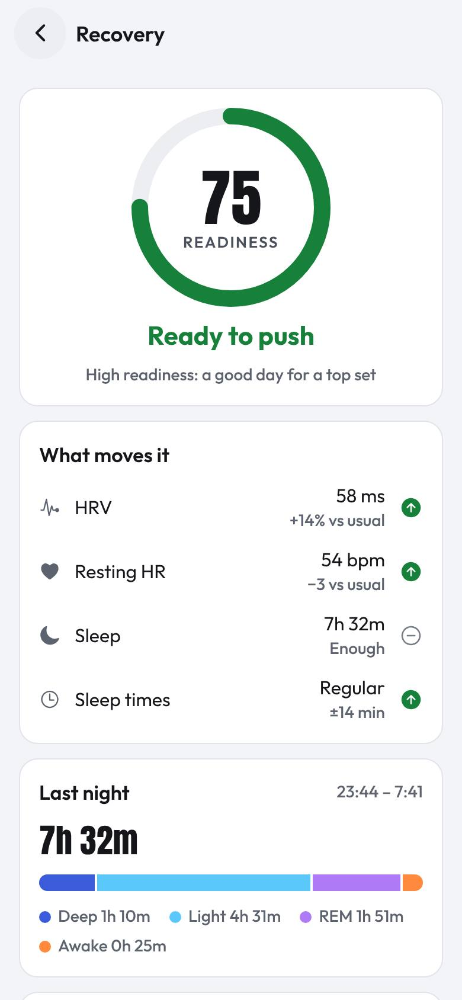
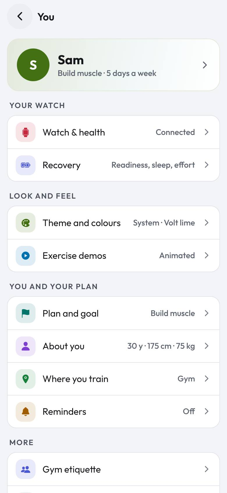

# Features

Every screen, what's on it, and why it's built that way. For step-by-step paths see [Journeys](journeys.md).

## Today

- **Hero card**: the next workout in your plan's order, its exercises, length, place and target muscles.
  **Start** opens it ready; **Change** picks another plan day, a quick 20-minute session or a focus. On a rest day it
  reads **Rest day** and Start offers Train anyway, Quick 20 min or Pick exercises.
- **Three rings**: Training (workouts this week of your goal, opens Progress), Protein or Meals in gentle mode (opens
  the food sheet right there), and the third ring: **Readiness** when your watch has 4 nights, else sleep score, else
  steps, else **Add watch**.
- **Week dots**: which days you trained; today is circled.
- **Coach line**: one sentence that changes daily.
- **One note at the bottom** at most (finish setup, reminders off, cycle or pregnancy week…), each dismissible.
- **"Not today?"** chips when you skip a planned day (tired, busy, sore…) so reminders back off instead of nagging.

*Why*: one place answers "what do I do now", with one main button.

 

## The workout

- **Opens ready**: browse moves, read how-to, swap or edit; the clock starts on **Start workout**.
- **Header**: ⌄ minimises to the mini bar; the clock (with a live dot) is centred; live heart rate from a strap or
  watch; **⋯** opens Edit workout, Change workout, End workout early, Discard.
- **Exercise strip**: one segment per exercise, filled as you log; tap to jump.
- **Demo**: Animated (our drawn figure, with the target muscles glowing), Drawing, Photo or Video. Figures stay inside
  the frame for the whole rep; travelling moves (box jumps) cross it.
- **Set table**: kg and reps steppers (or a timer for timed holds), a tick to log. Ticking twice within 400 ms is
  ignored; un-ticking cancels the rest it started.
- **Add set**, **Swap** (with a reason) under the table.
- **Bottom bar**: pause, previous, sets done, **Next** (or **Finish workout** on the last exercise).
- **Rest panel**: countdown ring, pause, −15, +15, Skip; **Up next** after an exercise's last set; moves on by itself.
- **All sets done**: 3 seconds with **Add more**, then it saves and opens the Summary.
- **Swipe down** on the header (phone) minimises; reduced motion is honoured everywhere.

*Why*: sets save the moment you tick them, so finishing never needs a confirmation, and the only "finish" is the
whole workout.

 

## Summary

Time, sets, volume (or reps for bodyweight work), streak, heart rate when your watch has synced, new badges, Log a
meal and Add water. **Done** is pinned at the bottom so you can leave without scrolling past the celebration.

## Train

- **Your plan** with its days; tap a day for its exercises, **Start** for today's.
- **Search** and the whole **library** by muscle (body map), equipment and level. Muscles with no moves for your
  place are hidden.
- **Other plans**, best for you first (the engine's pick and alternatives), then the rest.
- **Plan page**: every day, the week's phase (Learn, Build, Push, Deload), why it fits you.
- **Exercise page**: demo, sets × reps, rest, calories, how to do it, alternatives, **Train this now**.

 

## Progress

**This week**: workouts, volume and minutes. Then one door each: **Strength** (best lift; volume chart, or reps when
it's bodyweight), **Body weight** (weigh-ins and trend), **Consistency** (streak, calendar history), **Body & watch**
(sleep, resting heart rate, steps, HRV from your watch), **Recovery** (readiness, effort, sleep stages, trend). Then
**Achievements** (badges and levels).

 

## Recovery

Readiness ring with its word (Ready to push, Train as planned, Take it easy) and advice; **What moves it** (HRV,
resting HR, sleep, sleep times, each against your usual); flags (breathing rate, SpO2); last night's stages; effort for
7 days and the last workout's heart-rate zones; 14-day trend. Without a watch: **Connect your watch**.
How it's worked out: [Data and sources](data-sources.md#readiness).

 

## Fuel

- **Totals**: kcal left of your target, protein and water (gentle mode: meals only).
- **Log food** (main button) and a **+** on each meal. The sheet opens on Foods with **Log again**; tap to log.
  Search covers foods and recipes; the first row logs exactly what you typed with an estimate. **Your own** needs only
  a name. **Undo** right after.
- **Breakfast, Lunch, Snack, Dinner**: tap to see and remove items.
- **Water**: one tap a glass.
- **Tips for you** (folded): today's meal plan with recipes, protein picks, light filling foods, supplements to tick.
- Diet asked once; foods outside it still findable under "Not in your diet".

 

## You

Behind the avatar on every tab.

- **Your watch**: Watch & health (connect, sync, strap, ring, import) and Recovery.
- **Look and feel**: Theme and colours (System, Light, Dark; accent: Volt lime, Gold, Ember, Glacier, Rose; the colour
  legend), Exercise demos (default demo type), Haptics.
- **You and your plan**: Plan and goal (goal, level, days with a better-fitting plan offered, find a new plan),
  About you (shows "Not set" for anything you skipped), period tracking when on, Where you train (and home gear),
  Reminders.
- **More**: Gym etiquette, Your data (export JSON, export sets CSV, erase).

 

## Watch & health

Your watch card (sources, last sync, what arrived, Sync now, Disconnect), Fitbit and WHOOP status cards, Recovery,
then **More ways**: heart-rate strap, smart ring, import from a file, Gadgetbridge. Full steps:
[Connect your watch](connect-devices.md).

## Everywhere

- **Mini bar** above the tabs (and at the bottom of other pages) while a workout runs: exercise, time, sets, ✓ to log
  the next set.
- **Centre button**: Start, or **Resume 12:34** while running.
- **Tap the current tab** to scroll to the top.
- **Sheets** for every action; drag down, tap outside or Back to close.
- **Reminders** at your training time, backing off after missed days.
- **Unknown links** show an app page with Back to Today.
- **Accessibility**: tabs are announced as tabs with their state; buttons have labels; reduced motion turns
  animations into fades.
