# Features

Every screen, what's on it, and why it's built that way. For step-by-step paths see [Journeys](journeys.md).

## Today

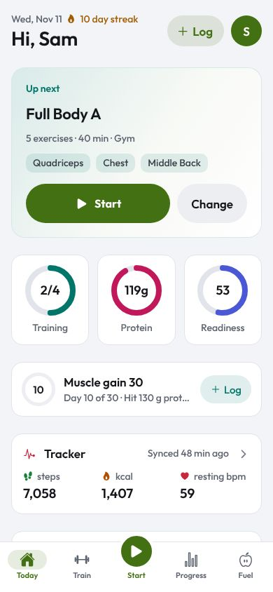

- **Header**: the date and your streak on one small line (tap → Calendar), "Hi, Sam" (or "Today" without a name),
  **+ Log** and your avatar (→ You).
- **+ Log** opens the **Quick log** sheet: Food, Water (+ one of your glasses, Undo), Weight (stepper + Save), Supplements
  (tick today's), How do you feel (4 choices; the workout adjusts to it).
- **Hero card**: the next workout in your plan's order, its exercises, length, place and target muscles. **Start** opens
  it ready; **Change** picks another plan day, a Short on time session or a focus. On a rest day it reads **Rest day**
  and names the next workout.
- **Get started** card (new users, under the hero): five rows that tick themselves from what really happened. × hides it
  for good. See [Journeys › Your first days](journeys.md#2-your-first-days-the-get-started-card).
- **Three rings**: Training (workouts this week of your goal, opens Progress), Protein (or Meals in gentle mode; opens the
  food logger), and the third ring: **Readiness** when your watch has 4 nights, else sleep score, else steps, else
  **Water** (ml under 1 L, then litres), so the third ring is always one you can fill.
- **Challenge pane**: the running challenge's day ring, name, today's task and one tonal action (Start, Log, + Glass, Did
  it), a tick when today is done, a make-up reminder; with none running, "Try a 21-day challenge · picked for you".
- **Tracker pane**: steps, kcal and resting bpm from your watch with "Synced 48 min ago", or live bpm while a strap or ring
  streams; with nothing connected, "Connect a watch". Hidden while Get started still lists the watch.
- **This week** card: a dot per day; the whole card opens the Calendar.
- **Coach line**: one sentence that changes daily, and at most one dismissible note.
- **"Not today?"** chips when you skip a planned day (tired, busy, sore…) so reminders back off instead of nagging.

*Why*: one place answers "what do I do now", with one main button (Start). Everything you log goes through one sheet.

 

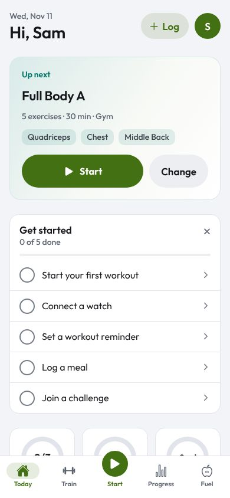
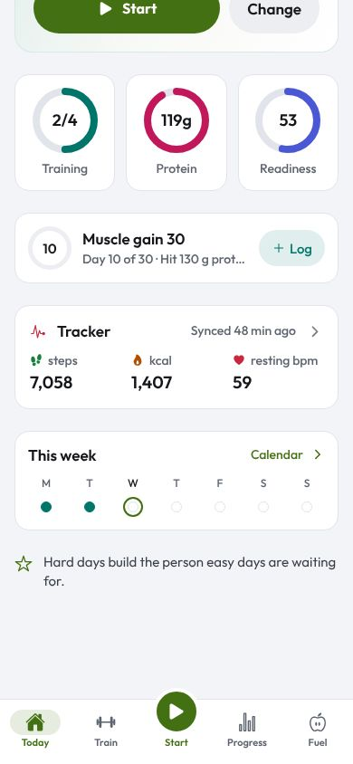
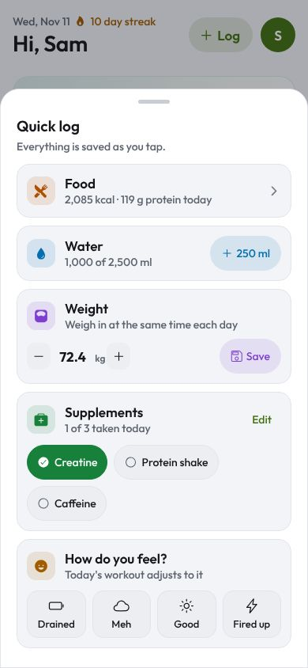

## The workout

- **Opens ready**: browse moves, read how-to, swap or edit; the clock starts on **Start workout**.
- **Header**: ⌄ minimises to the mini bar; the clock (with a live dot) is centred; live heart rate from a strap or
  watch; **⋯** opens Edit workout, Change workout, End workout early, Discard.
- **Exercise strip**: one segment per exercise, filled as you log; tap to jump.
- **"Last time 28.5 kg × 10 · Go heavier: +2 kg"** under the name when you hit every target rep last time; the weight
  is already raised (+2.5 kg barbell and machines, +2 kg dumbbells and kettlebells). Off in Deload weeks, for timed
  holds, for under-18s and in pregnancy or after birth.
- **Demo**: Animated (our drawn figure, target muscles glowing), Drawing, Photo or Video.
- **Set table**: kg and reps steppers (or a timer for holds), a ✓ per row. **Plates** in the header for barbell and
  EZ-bar moves opens the plate calculator (bar weight adjustable; plates 25 to 1.25 kg; says what can't be made).
- **Add set**, **Swap** (with a reason) under the table.
- **Bottom bar**: pause, then the one filled button **✓ Done · log set 2** (logs the next open set and starts the rest).
  Under it **‹ Previous** and **Next exercise · logs set 2 ›**, which logs the set in progress with the numbers shown and
  moves on (other sets of that exercise stay open). A tip explains this on the first two workouts; every such Next
  shows an **Undo** toast for 5 seconds. On the last exercise the right-hand link is **Finish workout**, and it becomes
  the filled button once that exercise is done.
- **Rest panel**: countdown ring, "Rest · up next" with the next set's numbers (or the next exercise), −15 / +15,
  **Pause** (becomes Resume), **Next exercise** (tonal, ends the rest and moves on, logs nothing) and **Next set**
  (filled). After an exercise's last set the filled button is **Next exercise**. A tap in the panel's first half second,
  or a second tap on Done within 0.6 s, is ignored, so a double tap never logs two sets.
- **All sets done**: 3 seconds with **Add more**, then it saves and opens the Summary.
- **Rest-over alert** on the phone names what's next ("Set 3 · Bench press 60 kg × 8") on its own "Rest timer"
  notification channel, so other nudges can be muted without losing it.

*Why*: the owner asked that Next logs what you just did and that resting shows every choice plainly. Sets save the
moment they're logged, so finishing never needs a confirmation, and there is only one Finish.

 

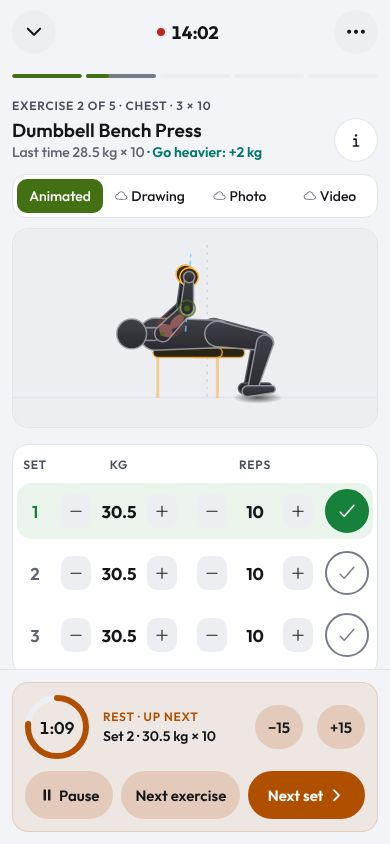
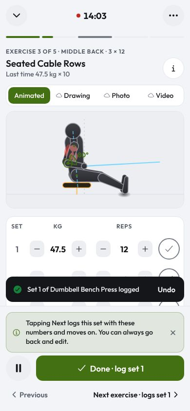
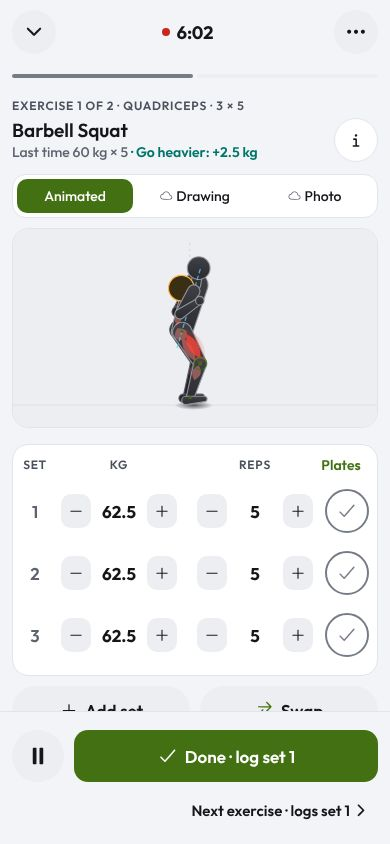
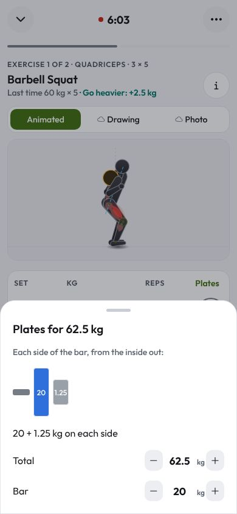

## Summary

Time, sets, volume (or reps for bodyweight work), day streak, heart rate when your watch has synced, new records and
badges, **Next time · Full Body B** (plan workouts), and a read-only challenge line when this workout counted ("Challenge
day done", or "workout counted · Still today: Hit 130 g protein"). Log a meal and Add water (one of your glasses) are quiet
buttons; **Done** is pinned at the bottom.

## Train

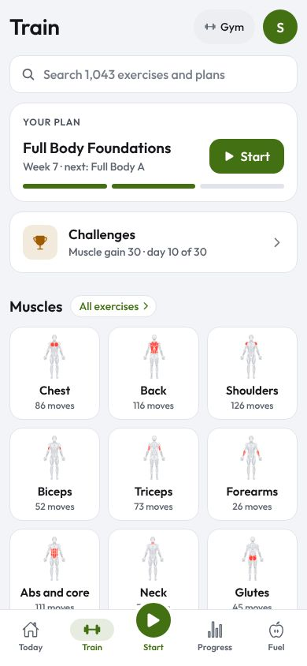

- **Your plan** with its week and next workout; **Start** for today's.
- **Challenges** door: the running challenge's day, or how many there are.
- **Search** 1,043 exercises and plans (moves your plans use rank first), and the **library** by muscle (body map),
  equipment and level. No hits → "Browse all exercises".
- **Other plans**, best for you first.
- **Plan page**: every day, the week's phase (Learn, Build, Push, Deload), why it fits you; "Switch to this plan" when
  you already have one.
- **Exercise page**: demo, sets × reps, rest, calories, effort, how to do it, alternatives, **Train this now**.

 

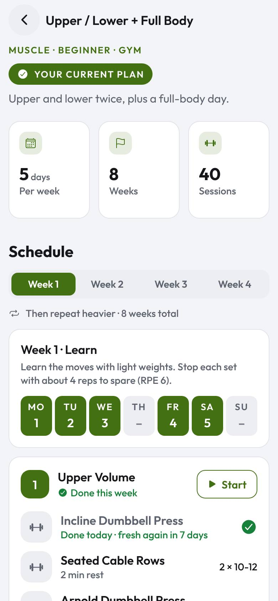
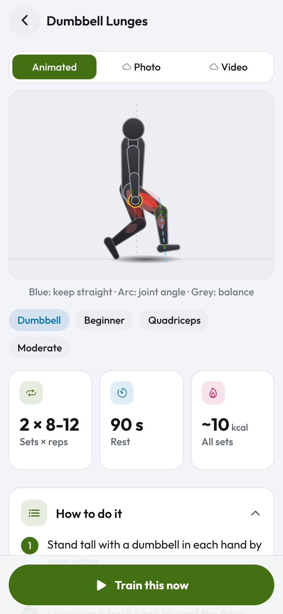

## Challenges

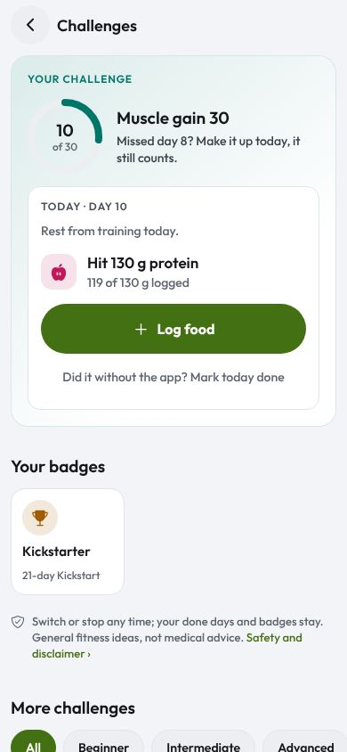

- **27 challenges**, 14 to 30 days: 12 Beginner, 11 Intermediate, 4 Advanced, across Weight loss, Muscle gain, Strength,
  Cardio, HIIT, Core, Mobility, Steps, Habits and Consistency. Examples: 21-day Kickstart, Squat 30, Plank 30, Walk to run
  28, Steady and strong 28 (55+), Gentle core after birth, Desk 14, Muscle gain 30, Burpee 30, Zone 2 28, Soft 30
  (75 Soft without the reset), Advanced strength 28, Calisthenics 28, Hybrid 28.
- **Your challenge** on top (day ring, cheer line, today's task with one button) or **Picked for you** (chosen from your
  goal, level, age, place, kit and life stage). Then **Your badges**, level and goal filters, *Recommended for you* and
  each goal's best two with **See all**. Pills show level, days, minutes a day, and kit or audience (Kettlebell, Made
  for 55+). A note says you can switch or stop any time.
- **Challenge page, not joined**: the days grid, what you'll do (every task counted), the rules, **Join · starts today**
  and "Leave any time" with the safety link. If another challenge runs, "Switch challenge?" says what happens first.
- **Joined**: Day X of N, streak, free misses left, % done, stars at ¼ ½ ¾; **Today · day N** with its task(s) and one
  button; "Did it without the app? Mark today done" (a hand tick marks the whole day); **Make up day 8** when a missed day
  can still be done within two days; **Your days** grid (done, missed, rest, today; tap a past day to see or mark it);
  **Need a break?** row to leave without losing your done days.
- **Days tick themselves** from what the app sees: any finished workout (or a 15+ minute watch workout), a specific
  session started from the challenge, cardio minutes, steps from your watch, protein from logged meals, water. Rest days
  and days you marked sick, travel or rest count as done.
- **Finish**: badge, and **Up next** (the next level of the same goal). Over without the badge: an honest "17 of 21 days"
  and Go again; never a reset to day 1.

*Why*: the owner wanted motivation for every level and more than weights; research favoured rest days, make-ups and
milestones over all-or-nothing streaks (no 75 Hard).

 

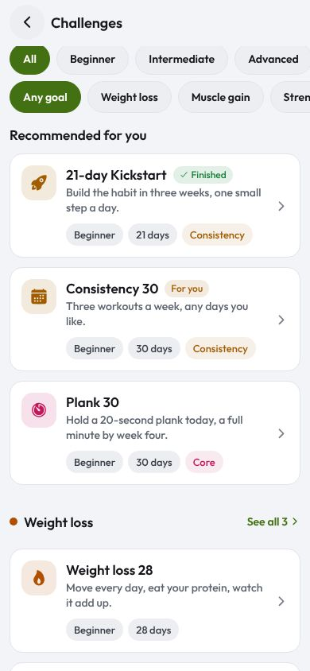
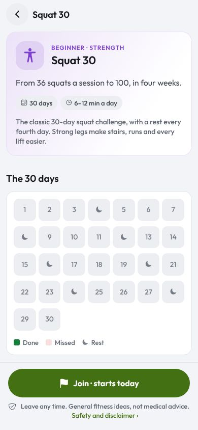
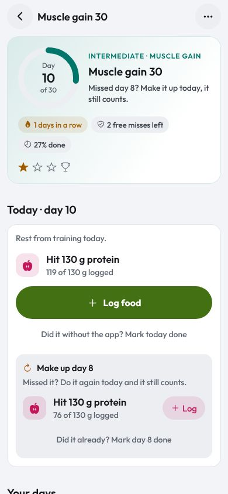
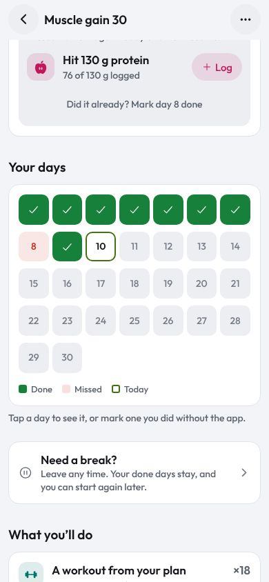
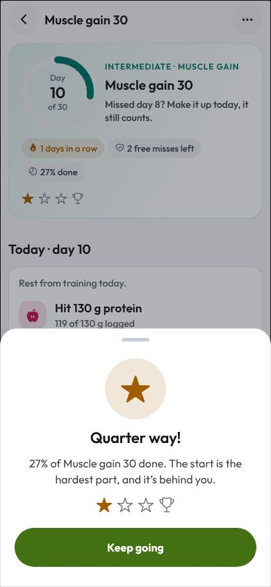

## Progress

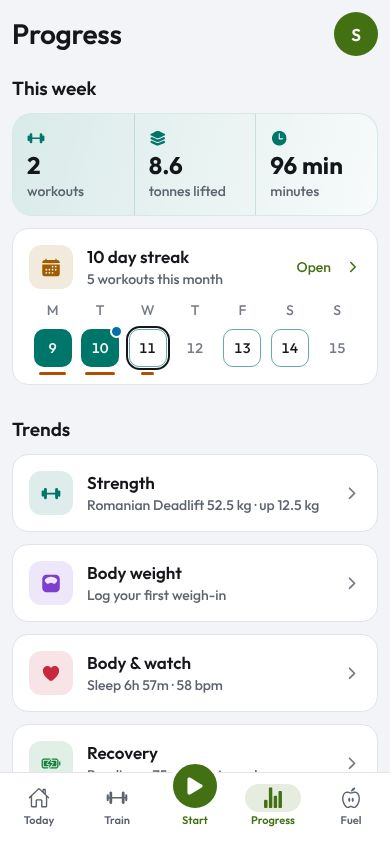

**This week**: workouts, tonnes lifted and minutes (a new user sees "Your first workout fills this in"). **Calendar
card**: streak, workouts this month and this week's days in the calendar's colours; opens the Calendar. **Trends**:
Strength (best lift, "about 70 kg for one rep"), Body weight, Body & watch (sleep, resting heart rate, steps, HRV),
Recovery. **Achievements** (level and medals).

 

## Calendar

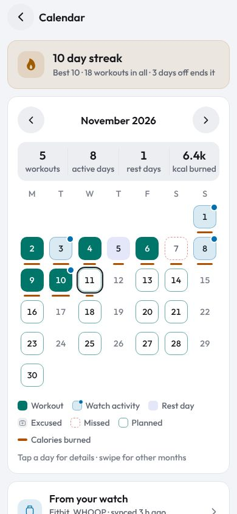

Streak strip, then the month: arrows or swipe, "Back to today", a numbers row (workouts · active days · rest days · kcal
burned), the grid and its legend. Below: **From your watch** (which apps sent data in 30 days, last sync, what they send;
opens Tracker), Sessions per week and Habits.

| Marker | Means |
|---|---|
| Filled teal | A workout you logged |
| Soft blue fill, blue dot | Activity from your watch (teal + blue dot: both) |
| Indigo wash | Rest day (past, nothing planned or done) |
| Grey with an icon | Marked sick, travel or rest |
| Faint red dashed ring | A planned day that was missed |
| Teal outline | Planned (today or later) |
| Dark ring | Today |
| Orange bar under the day | Active calories burned (full at 800 kcal) |

Days before you started are blank, never "rest". "Planned" means a weekday with a workout reminder on, or else a
training day in your plan's week.

**Day sheet**: calories burned as one number and where it came from ("Active calories from Fitbit and WHOOP", with the
workouts already counted in it, and resting calories when sent), your workouts (time, sets, volume, heart rate, matched
watch workout, Exercises, Delete), watch workouts, steps, sleep and resting heart rate, food and water, and **Mark this
day** (Rest day, Sick, Travel). Gentle mode hides every calorie figure.

 

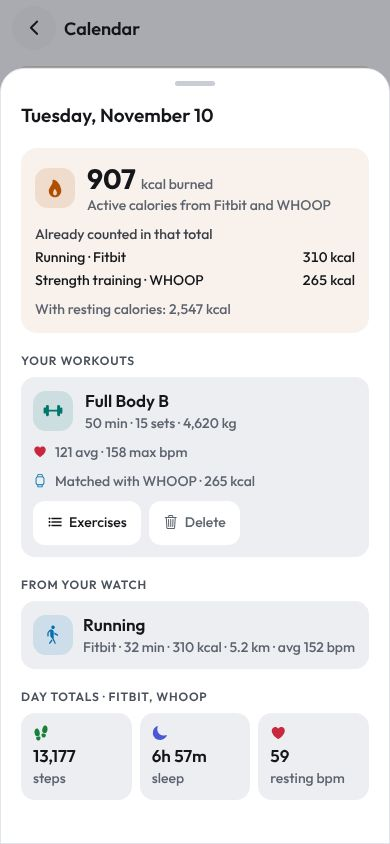
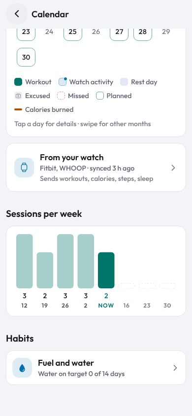

## Recovery

Readiness ring with its word (Ready to push, Train as planned, Take it easy) and advice; **What moves it** (HRV,
resting HR, sleep, sleep times, each against your usual); flags (breathing rate, SpO2); last night's stages; effort
("Effort 44 / 100") for 7 days and the last workout's heart-rate zones; 14-day trend. Without a watch: **Connect your
watch**. How it's worked out: [Data and sources](data-sources.md#readiness).

 

## Fuel

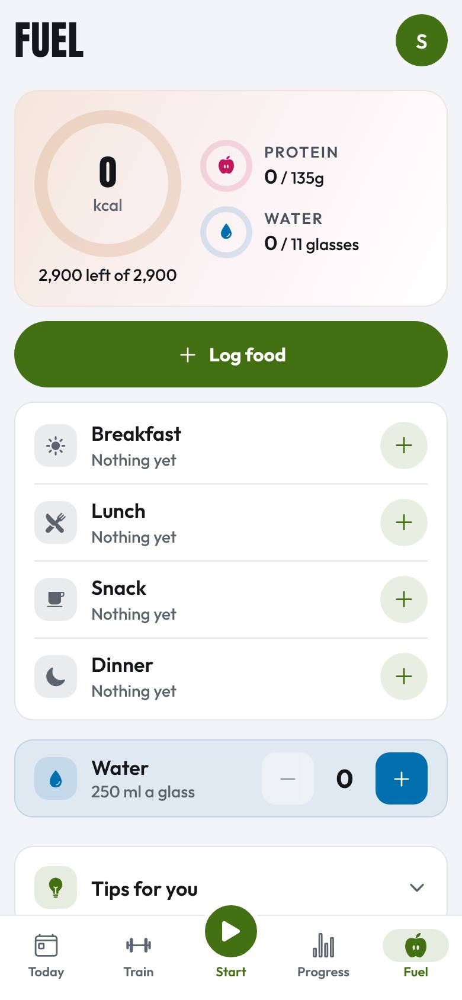

- **Day bar**: Today, and ‹ back up to 6 days to log a missed meal.
- **Totals**: kcal left (ring), protein g of target with a bar, water ml of goal with a bar (gentle mode: meals only).
- **Log food** (the main button) and a **+** on each meal. The sheet: Yesterday / Today, meal, search (foods, recipes,
  or log exactly what you typed with an estimate), **Log again**, Foods / Recipes / **Your own** (name, kcal, protein,
  optional carbs and fat). **+** logs one serving; tapping a food opens the **serving picker** (½ steps, scales the
  numbers). **Undo** right after.
- **Meals**: Breakfast, Lunch, Snack, Dinner with time, kcal and protein; tap a food to edit, move or remove it.
- **Protein card**: grams to go, a suggestion that covers it, quick protein picks for your diet.
- **Water card**: ml of goal, − and **+ Glass · 250 ml**, and the **Water** sheet (goal in ml, glass size 150–750 ml,
  drink reminder).
- **Supplements card**: tick chips for what you take today; **Reminders ›**; none yet → "Add what you take".
- **Tips for you** (folded) and **Trends** (calories, protein, water and meals chart).

 

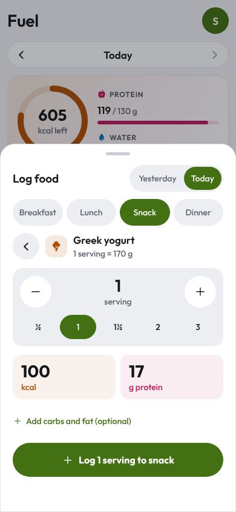
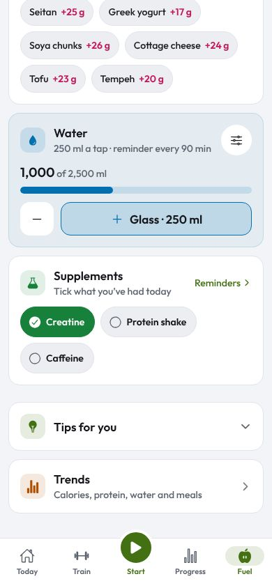
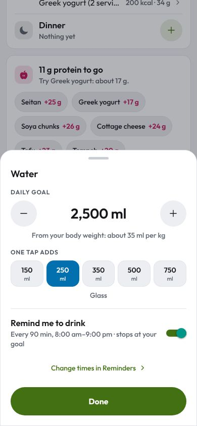

## Supplements

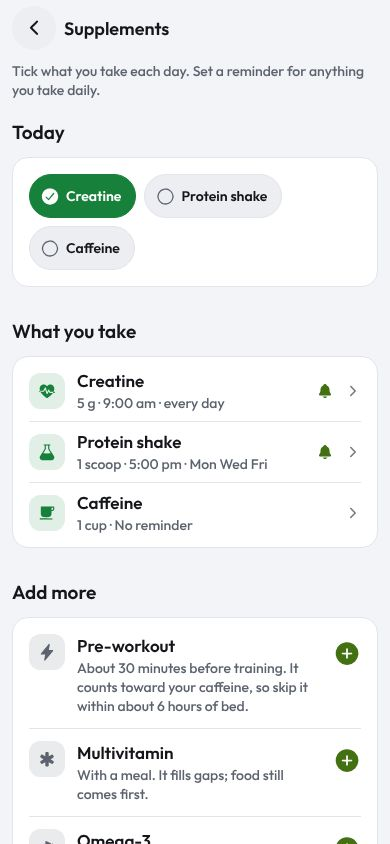

Today's ticks, **What you take** (dose · reminder times · days, a bell when a reminder is on) and **Add more** from the
catalogue with one line of guidance each, or **Add something else**. Each one's sheet: dose, up to 3 reminder times
(each with days and a switch, a time wheel), notes about quiet hours and late caffeine, Remove / Done. A protein shake
tick offers **Log it** as food. Strong supplements are hidden for under-18s and in pregnancy or after birth. A safety
note sits at the bottom.

 

## Reminders

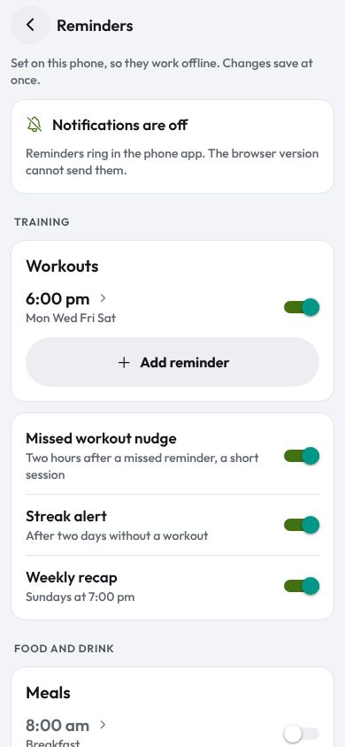

Grouped so it scans: **Training** (workout times with days, Add reminder, missed workout nudge, streak alert, weekly
recap on Sundays at 7:00 pm) · **Food and drink** (meal times, water every N minutes in ml against your goal, stopping at
it, and **Supplements ›**) · **Through the day** (motivation and tips, desk and eye breaks) · **Quiet hours**. Times read
"6:00 pm" everywhere. Reminders are set on the phone and work offline; the phone asks permission the first time you turn
one on. The web preview says "Notifications are off" because browsers can't get them.

 

## Tracker

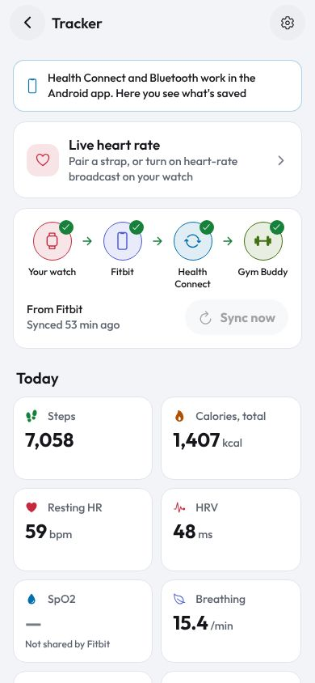

Everything your watch, strap or ring sends, in one place:

- **Live heart rate**: beating heart, zone, the last minute as a line, while a strap, ring or broadcasting watch
  streams. Otherwise a row to pair one.
- **Where the data comes from**: the data path with ticks, "From Fitbit · Synced 53 min ago", **Sync now**.
- **Today**: tiles for steps, total and active calories, resting HR, HRV, SpO2, breathing rate, sleep, VO2 max and
  weight (a skin temperature tile appears only if a value ever arrives). A missing number says
  why: "Not shared by Fitbit", "Nothing today yet".
- **Heart rate today**: a 10-minute line, low and high, minutes in each zone.
- **From your watch**: the watch's workouts with kcal, average heart rate and distance.

Empty state: the path diagram, one line and **Connect your watch**, plus a row for straps and rings.

 

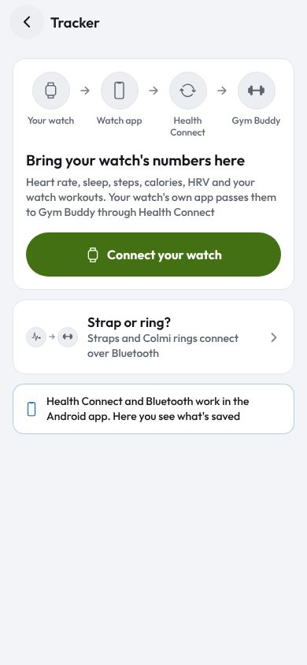
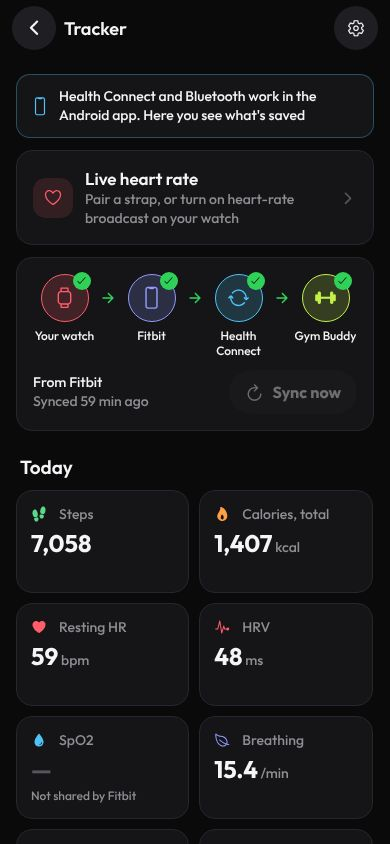

## Watch & health

Status first: one card with the data path (a tick on each hop seen working), "From Fitbit · synced 53 min ago" and one
action (**Connect your watch**, or **Sync now** and **Add a watch** once connected). Then doors to **Tracker**,
**Recovery** and **Body & watch**, and **More ways**: heart-rate strap, smart ring, import from a file (Gadgetbridge
note folded). Disconnect is at the bottom. Full steps: [Connect your watch](connect-devices.md).

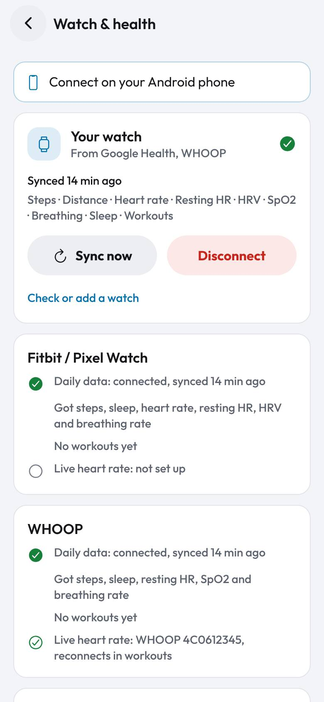
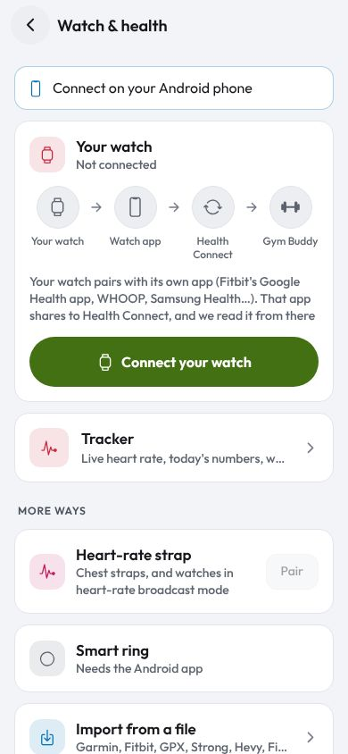

## You

Behind the avatar on every tab.

- **Watch & health**: Connect a watch (or Connected watch · Fitbit), Tracker, Recovery.
- **Goals**: Challenges, Plan and goal, Where you train.
- **Reminders**: Workout, Meals and water, Supplements.
- **Look and feel**: Theme and colours (System, Light, Dark; accents Volt lime, Gold, Ember, Glacier, Rose; the colour
  legend), Exercise demos, Haptics (phone only).
- **More**: About you, period log when cycle tracking is on, Gym etiquette, Your data (export JSON, export sets CSV,
  erase), **Safety and disclaimer**.

 

## Safety and disclaimer

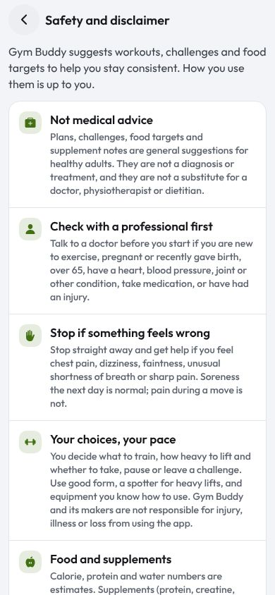

A plain page (You › More, and the "Safety and disclaimer ›" link under the quiet safety notes): not medical advice;
check with a professional first (new to exercise, pregnant or after birth, over 65, heart, blood pressure, joint or other
conditions, medication, recent injury); stop if something feels wrong; your choices, your pace; food and supplements are
estimates. Short safety notes appear where you commit to something: under **Use this plan** in setup and on the plan
page, under **Join** on a challenge, on the Challenges page, at the bottom of Supplements and of each profile section.

 

## Everywhere

- **Mini bar** above the tabs while a workout runs: exercise, time, sets, ✓ to log the next set; during a rest
  "Rest 1:06 · 4/14 sets" and **Next ›**; paused shows "Paused · rest 1:06".
- **Centre button**: Start, or **Resume 12:34** while running.
- **Tap the current tab** to scroll to the top. Today's tab icon is a house.
- **Sheets** for every action; drag down, tap outside or Back to close (Back closes a sheet before leaving a screen).
- **One-time hints** (Log on Today, Next in the workout, editing a food) show at most twice and can be closed.
- **Unknown links** show an app page with Back to Today.
- **Accessibility**: tabs are announced as tabs with their state; buttons have labels; touch targets are at least 44 px;
  reduced motion turns animations into fades.
- **Type**: Outfit only, sentence case; bold is kept for numbers.
