# Journeys

The paths people take through the app, in the order they usually meet them. Each step names the screen and the tap.
Screenshots are from the web build at 390 × 844 (light theme unless the name starts with `dark-`).

## 1. First launch and setup (about a minute)

1. **Welcome**: "Your gym buddy", one line on what the app does, three short benefits and "5 quick steps, about a
   minute". **Get started** is the one main button. **I've used gym apps before · skip** goes straight to Today with
   sensible defaults (Today then offers "Get a plan made for you").
2. **Your goal** (Step 1 of 5): Lose fat, Build muscle, Lift heavier or Stay healthy. One tap moves on. Nothing is
   picked for you in advance, so what lights up is always your own answer.
3. **Where you train** (Step 2): Gym, Home (then tick the gear you have; none is fine), Both, or Office.
4. **Days a week** (Step 3): 2 to 6.
5. **Your plan** (Step 4): the plan built for those days, its days, and why it was picked ("Fits your 3 days", "Made for
   beginners"). **Use this plan** moves on. **See the full plan** shows every day first. A quiet safety line sits under
   the button ("general fitness ideas, not medical advice", with a link to Safety and disclaimer).
6. **What should we call you?** (Step 5, optional): type a name and the button becomes **Let's go, Alex**; or tap Skip.
   **Add age and weight for food targets** opens the optional About you step (gender, age, height, weight, diet).

A round back button on every question goes one step back (from Goal, back to the welcome). The days you pick are a
hard rule: pick 5 and you get a 5-day plan, never a 3-day one. See
[Data and sources › Plan engine](data-sources.md#plan-engine).

Setup no longer asks for notification permission and no longer creates a workout reminder by itself. The phone asks
the first time you switch a reminder on (Today's Get started card has "Set a workout reminder" for that).

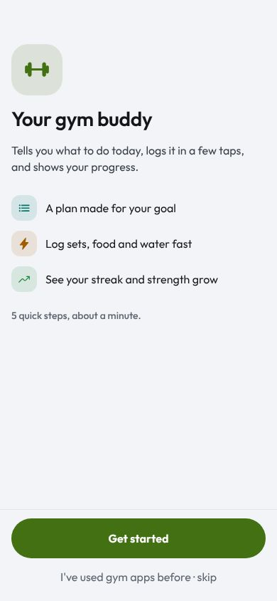
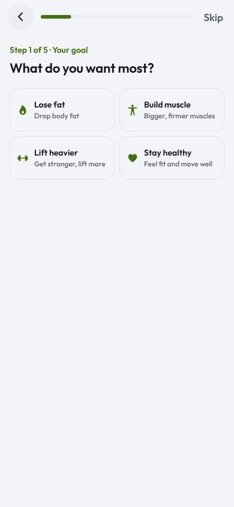
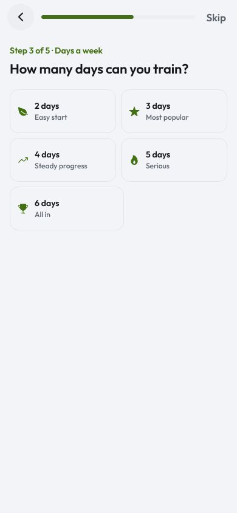
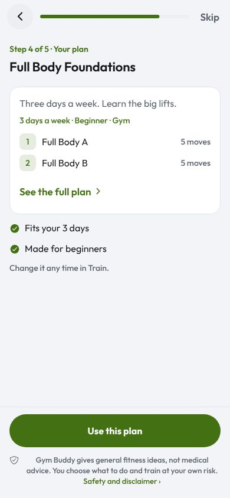
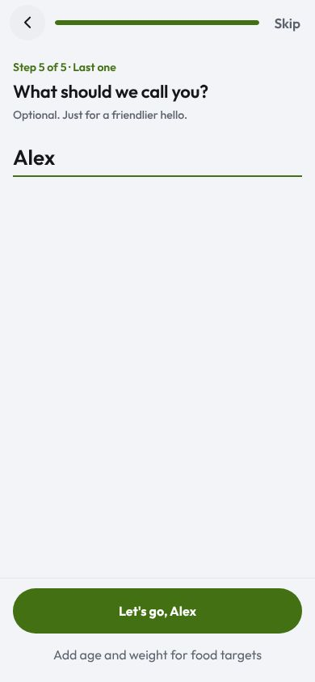

## 2. Your first days: the Get started card

Right after setup, Today shows the workout first (Start is the one next step) and, under it, a **Get started** card:

- Start your first workout (reads "Finish your first workout" while one is open)
- Connect a watch
- Set a workout reminder
- Log a meal
- Join a challenge

Each row goes straight to its place and ticks itself when the thing has really happened (a finished workout, watch data
arriving, a reminder switched on, a meal logged, a challenge joined). "2 of 5 done" shows progress. The × hides the card
for good; it also goes away once everything is done or after 5 workouts. While the card still lists "Connect a watch",
Today's Tracker pane stays hidden so you aren't asked twice.

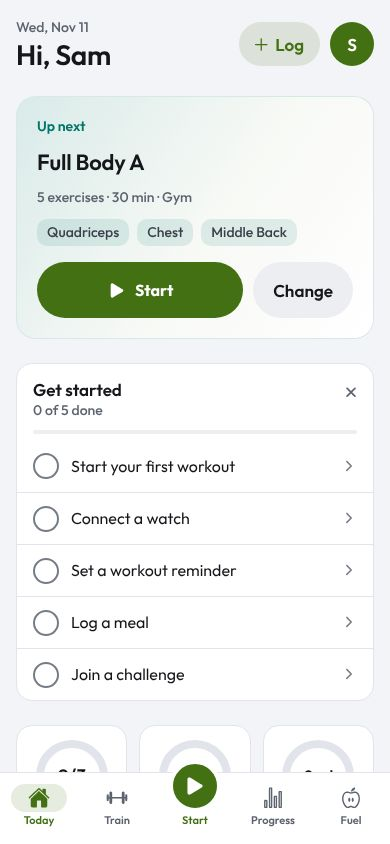
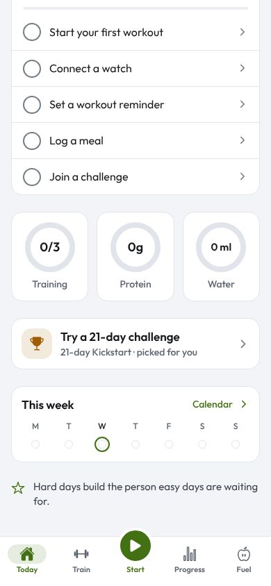

## 3. A training day

1. **Today** shows the next workout in the plan's own order. Tap **Start** (or the centre button).
2. The workout opens **ready**, not running. Look through the moves, read how to do each one (ⓘ), swap or edit before
   you begin. The clock starts only when you tap **Start workout**. If your readiness is low, a line under the first
   exercise says so.
3. **Do a set, then tap ✓ Done · log set 1.** It logs the next unlogged set with the weight and reps on screen and starts
   the rest. (The ✓ on each row still works too.) Weights are filled from last time; when you hit every rep last time,
   the line under the name says **Go heavier: +2.5 kg** (+2 kg for dumbbells) and the weight is already raised.
4. **Rest.** The rest panel names what's next ("Rest · up next · Set 2 · 30.5 kg × 10") with −15 / +15 and three plain
   choices: **Pause**, **Next exercise** (move on without more sets) and **Next set** (rest over, go now). After an
   exercise's last set it reads "Up next · Seated Cable Rows" and the filled button is **Next exercise**. When the rest
   runs out, the next exercise with sets left comes on screen by itself.
5. **Going straight on.** Under Done is **Next exercise · logs set 2**: it logs the set you're on with the numbers shown,
   leaves the exercise's other sets open and moves on. The first two workouts show a tip that says exactly this, and
   every such Next shows "Set 2 of Dumbbell Bench Press logged · **Undo**" for 5 seconds.
6. **Last exercise.** The only finish on screen: **Finish workout** (a link while sets are left, which asks first; the
   filled button once the exercise is done). Logging the very last set shows "All sets done · Saving…" for 3 seconds with
   **Add more**, then the workout saves itself and opens the Summary.
7. **Summary**: time, sets, volume, streak, heart rate from your watch, new records and badges, **Next time · Full Body B**,
   a challenge line when this workout counted for one ("Challenge day done · Day 10 of 30"), Log a meal and Add water
   (one of your own glasses). **Done** is pinned at the bottom.

To stop early, use **⋯ › End workout early** (Save and finish, Keep going, or Discard). Leave a running workout any time
with the ⌄ at the top left: it shrinks to a **mini bar** above the tabs (✓ logs the next set; during a rest it shows
"Rest 1:06" and **Next ›**), and the centre button reads **Resume 12:34**. A workout left open for 3 hours after its last
logged set saves itself with what was logged.

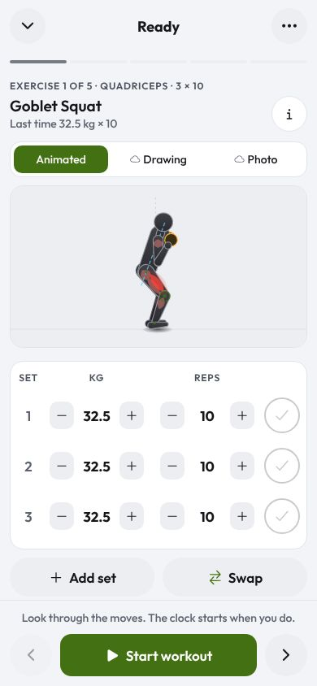
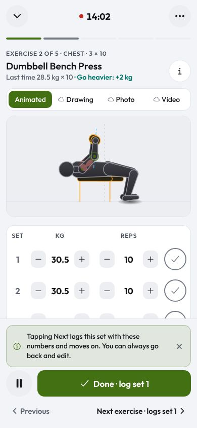
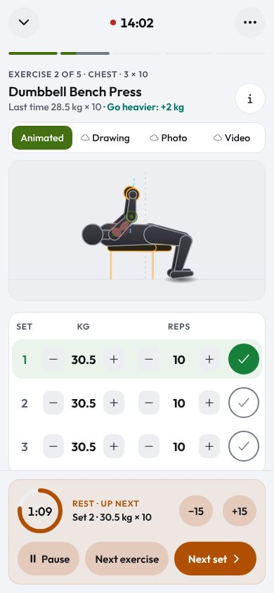
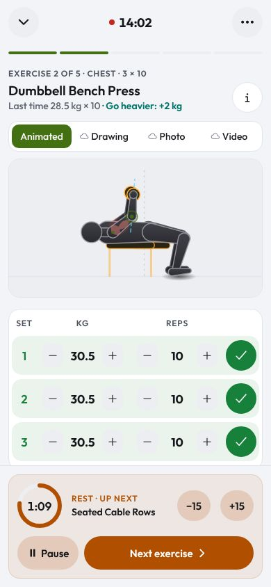

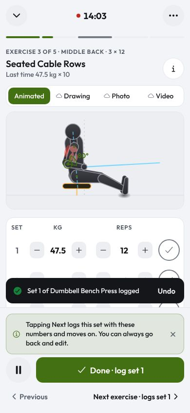
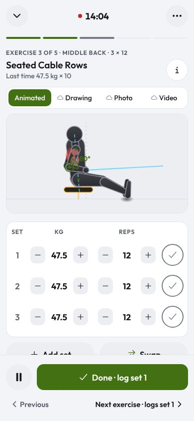
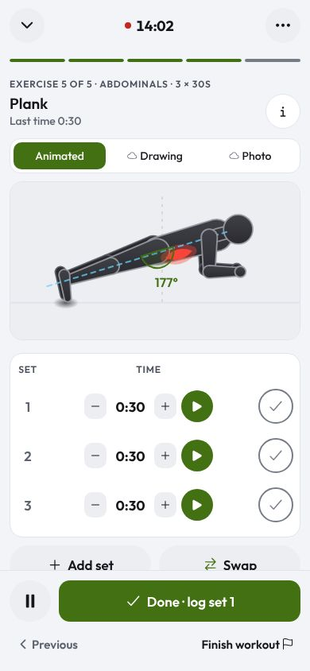
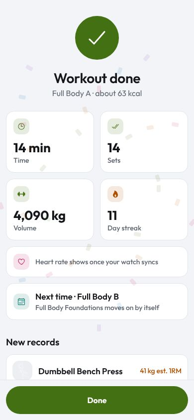

### Bar lifts: Go heavier and Plates

On a barbell or EZ-bar move the set table has a **Plates** button. It opens a sheet with what goes on each side of the
bar for the current weight ("20 + 1.25 kg on each side"), with steppers for the total and the bar. The Go heavier line
appears on any loaded move where you hit every target rep last time; it is off in Deload weeks, for timed holds, for
under-18s and in pregnancy or after birth.

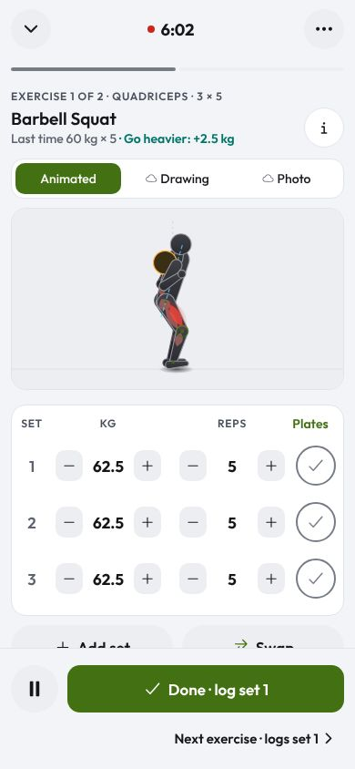
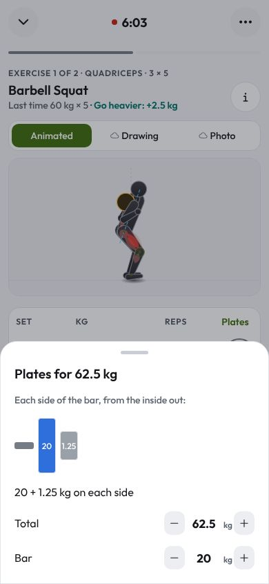

## 4. When a move doesn't work for you

- **Swap one exercise**: **Swap** under the sets. Say why: *Too hard*, *Equipment busy*, *Hurts* or *No equipment*.
  The list re-ranks for that reason. Sets you already logged stay with the original move.
- **Edit the workout**: **⋯ › Edit workout**. Move exercises up or down, change the number of sets, remove a move you
  haven't logged, swap, or add an exercise.
- **Change the whole workout**: **⋯ › Change workout**, or **Change** next to Start on Today. Pick another day of your
  plan, a **Short on time** session (no-equipment burn, brisk walk, incline walk), or a focus (Chest, Back, Shoulders,
  Arms, Legs, Glutes, Core, Mobility). Logged sets stay.

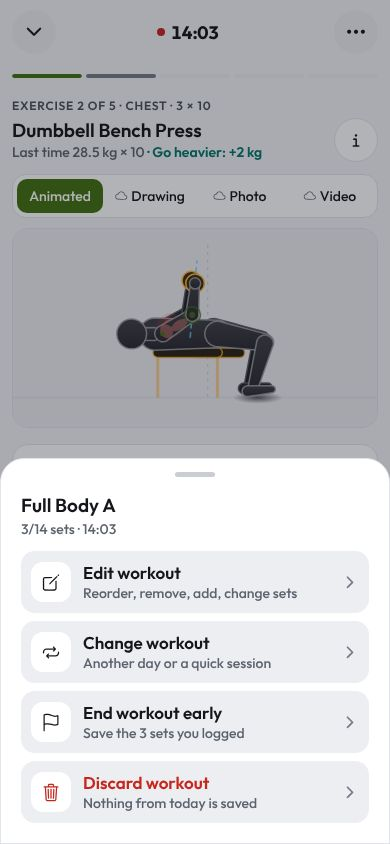
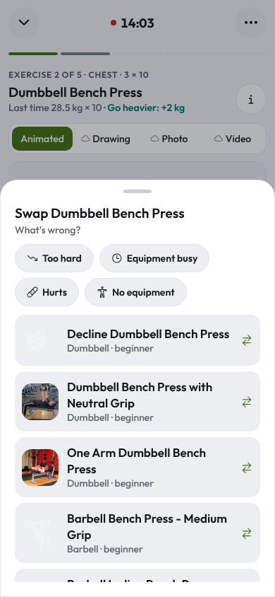
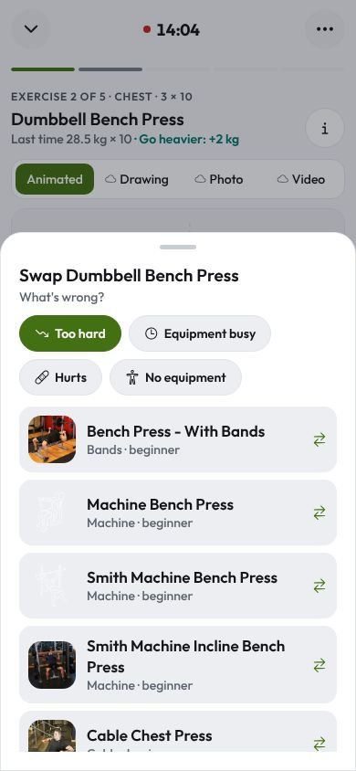
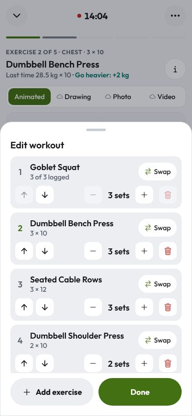

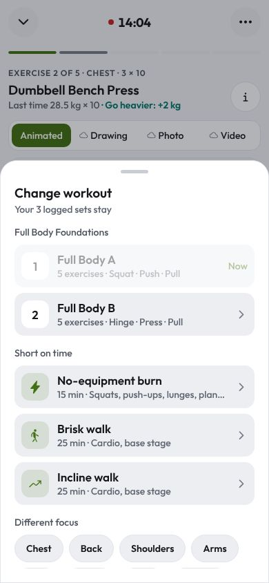
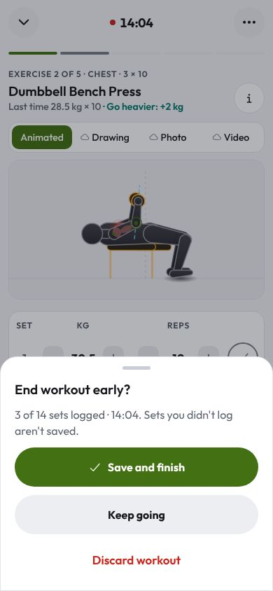
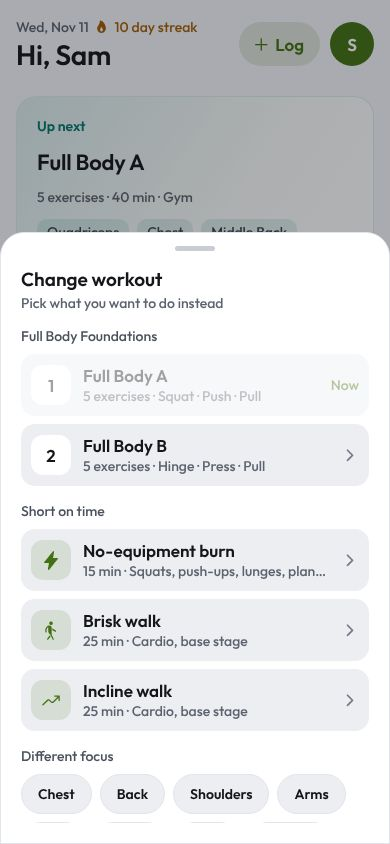

## 5. A rest day

Today's hero says **Rest day** and names the next workout ("Next: Full Body B on Fri"). Tapping it opens a sheet:
**Train anyway** (today's plan day), **Short on time** sessions, **Pick exercises**, or **Rest today**. A rest day still
counts for challenges (rest days count as done), and you can mark any past day as Rest day, Sick or Travel from the
calendar.

## 6. Logging anything from Today: + Log

**+ Log** in Today's header opens one **Quick log** sheet, the same everywhere:

- **Food**: today's kcal and protein; tap to open the food logger.
- **Water**: "1,000 of 2,500 ml" and **+ 250 ml** (your own glass size), with Undo for a few seconds.
- **Weight**: a stepper and **Save** (hidden in gentle mode).
- **Supplements**: tick what you've taken today; **Edit** opens Supplements.
- **How do you feel?** Drained, Meh, Good, Fired up. Today's workout adjusts to it.

Everything saves as you tap. A one-time hint under the header points at Log (shown at most twice).

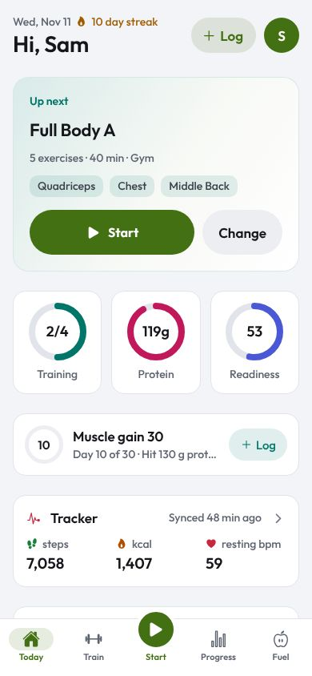
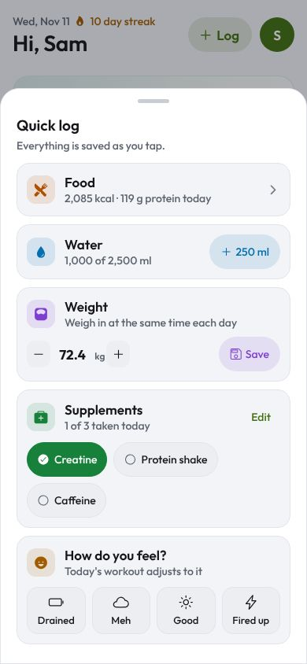

## 7. Logging food, protein and water

1. **Fuel › Log food** (the main button), the **+** on a meal row, Quick log › Food, or **Log a meal** on the Summary.
   Fuel opens on today; the **‹ ›** day bar goes back up to 6 days (the button then reads "Log food to yesterday").
2. The sheet has **Yesterday / Today**, the meal (picked by time of day), search, **Log again** (recent) and
   **Foods / Recipes / Your own**. The **+** on a food logs one serving in one tap, with Undo.
3. **Tap a food's name** for the serving picker: −/+ by halves or ½, 1, 1½, 2, 3; kcal and protein scale with it; carbs
   and fat are optional; **Log 1½ servings to snack**.
4. Not in the list? Type what you ate ("2 roti, dal and rice"). The first row logs exactly that with an estimate (about
   625 kcal, 20 g protein). A name alone is enough.
5. Each meal shows its foods, time, kcal and protein. **Tap a logged food** to fix its numbers, move it to another meal
   or remove it.
6. **Protein card**: "11 g protein to go", a suggestion that would cover it, and quick protein picks for your diet; a pick
   opens the serving picker on that food.
7. **Water card**: ml of your goal with a bar, **+ Glass · 250 ml** and −. The settings button opens the **Water** sheet:
   daily goal in ml (from your body weight until you change it), one-tap size (150, 250, 350, 500 or 750 ml) and the
   drink reminder.

Diet is asked once (Veg, Vegan, Egg, Fish, Non-veg). Foods outside your diet still show in search under "Not in your
diet". Gentle mode hides calories, protein grams and weight and counts meals instead.

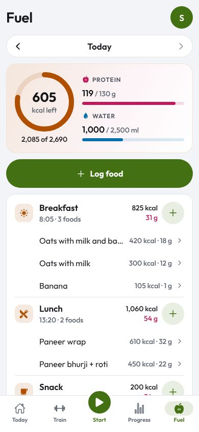
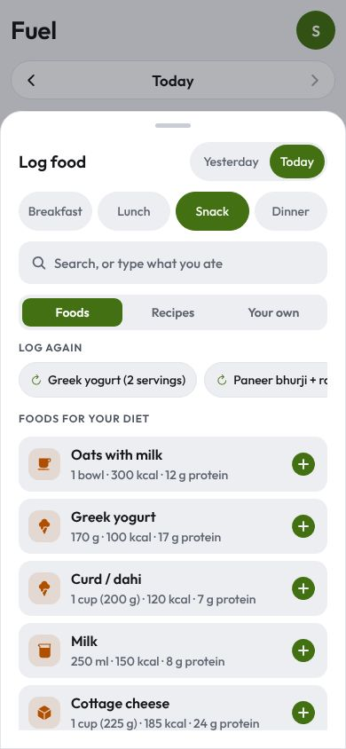
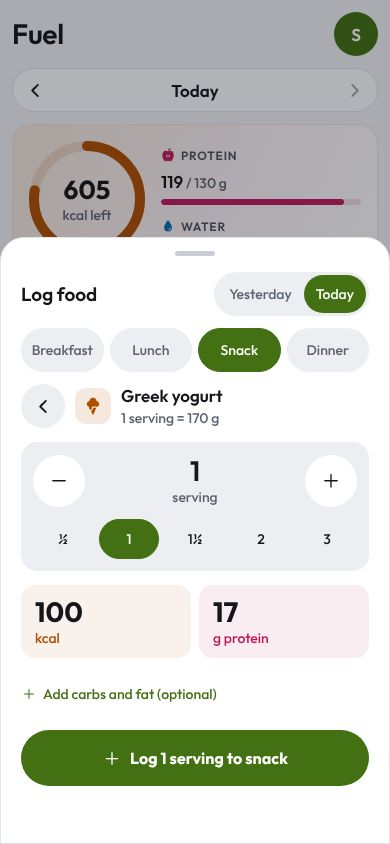
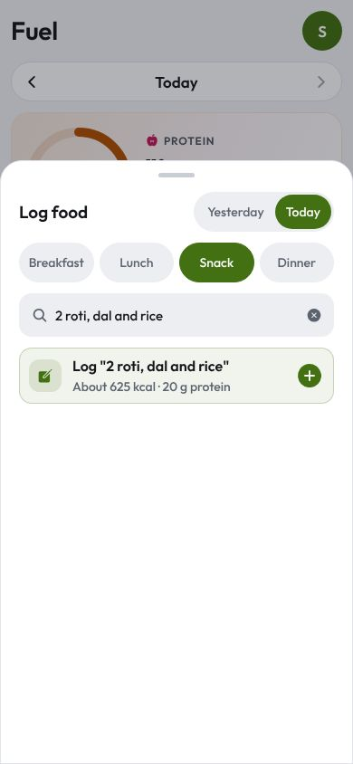

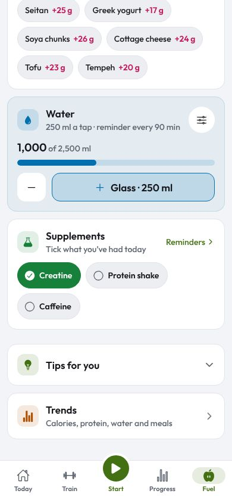
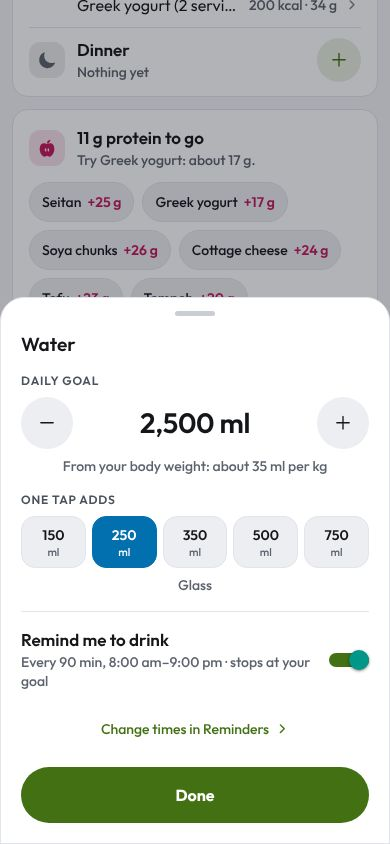

## 8. Supplements and their reminders

1. **Fuel › Supplements** card (tick what you've had today; **Reminders ›**), Quick log › Supplements › Edit, or
   **You › Reminders › Supplements**.
2. **Supplements** screen: **Today** ticks, **What you take** (dose, reminder times, days), and **Add more** from a short
   catalogue (protein shake, creatine, caffeine, pre-workout, multivitamin, omega-3, vitamin D, electrolytes, citrulline)
   each with one safe line of guidance, or **Add something else**.
3. Tap one to set the **dose** and up to **3 reminder times**, each with its days and an on/off switch. The phone asks for
   notification permission the moment you switch one on. Notes warn about caffeine close to bedtime and times inside
   quiet hours.
4. Ticking a **protein shake** offers **Log it** as food (+24 g protein), with Undo.

Under-18s and pregnancy or after birth don't see pre-workout, creatine or citrulline.

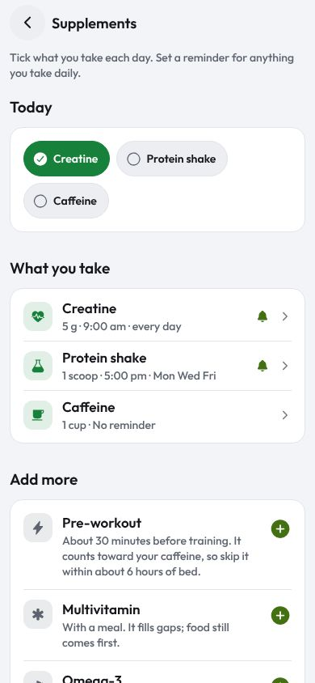
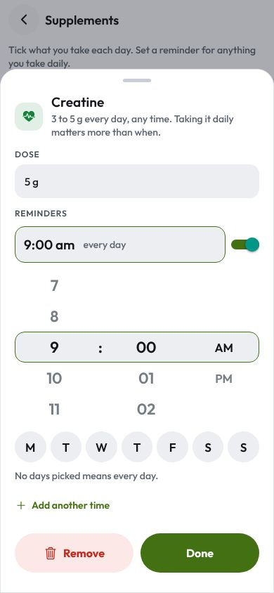

## 9. Joining a challenge

1. Today's **challenge pane** says "Try a 21-day challenge · picked for you" (or shows the one you're in), Train has a
   **Challenges** door under Your plan, and You › Goals › Challenges.
2. **Challenges** shows *Picked for you* with **Start this challenge**, *Your badges*, then **27 challenges** filtered by
   level (Beginner, Intermediate, Advanced) and goal (Weight loss, Muscle gain, Strength, Cardio, HIIT, Core, Mobility,
   Steps, Habits, Consistency). Unfiltered, it shows *Recommended for you* and each goal's best two with **See all**.
3. A challenge page shows the days grid (rest days marked with a moon), what you'll do, the rules, and **Join · starts
   today**, with "Leave any time" under it. If another challenge is running, a sheet asks first.
4. Once joined: **Today · day 10** with today's task and one button (Start, Log food, + Glass…), and "Did it without the
   app? Mark today done". Most days tick themselves from what you log (a workout, steps from your watch, protein, water).
5. **Missed a day?** A **Make up day 8** block lets you do it in the next two days and it still counts. Each challenge
   also has a few free misses, and days marked sick, travel or rest count as rest.
6. Stars at a quarter, half and three quarters, a badge at the finish, and **Up next**: the next level of the same goal.
7. **Need a break?** under Your days: "Take a break from Muscle gain 30?" Your done days stay in past challenges and you
   can start again any time. Nothing resets you to day 1.

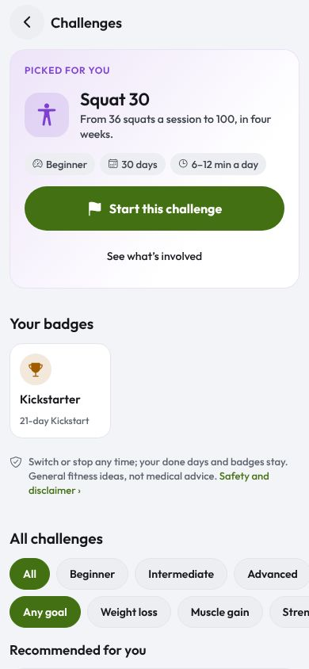
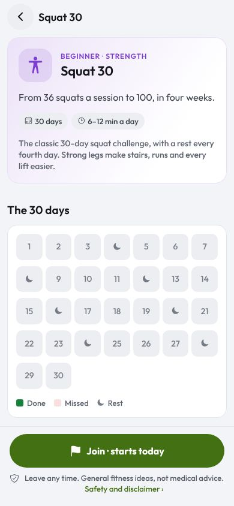
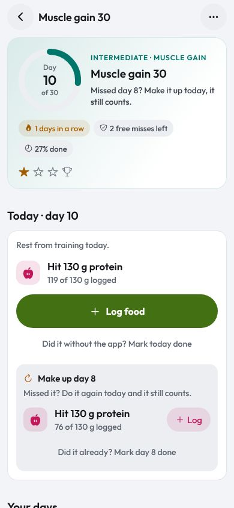
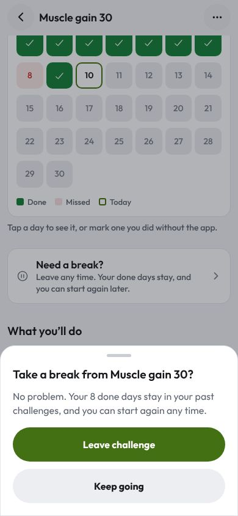

## 10. Looking back: the calendar

**Progress › Calendar card** (streak, workouts this month, this week in colour), Today's **This week** card, or the
streak line in Today's header opens **Calendar**. Arrows or a swipe change month. Tap any day for its sheet: calories
burned and where they came from, your workouts (sets, volume, heart rate, the watch workout matched to it), watch
workouts, steps, sleep and resting heart rate, food and water, and **Mark this day** (Rest day, Sick, Travel) on days
without a workout. The marker legend is in [Features › Calendar](features.md#calendar).

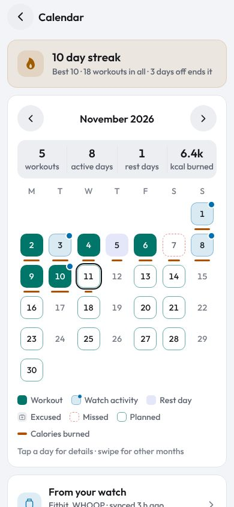
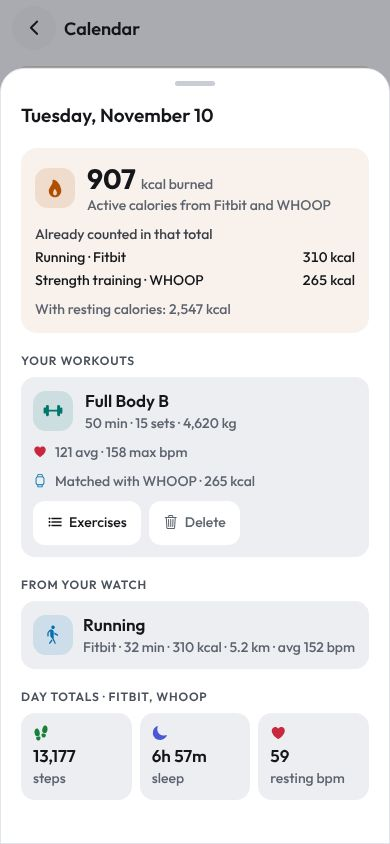
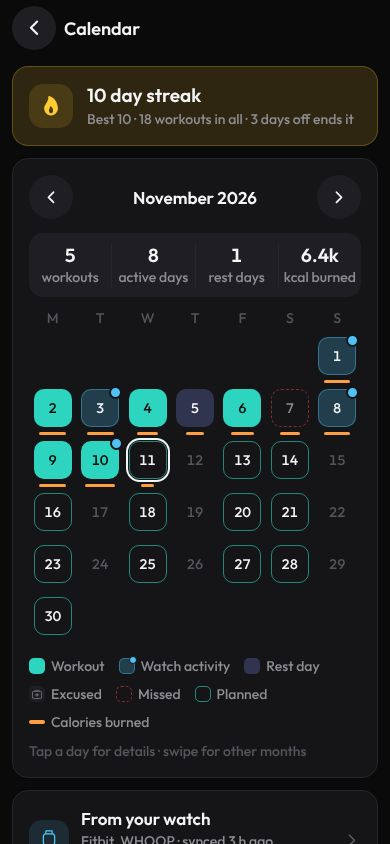

## 11. Connecting a watch

**Today › Tracker pane › Connect a watch**, the Get started row, or **You › Watch & health › Connect a watch**. Pick your
brand, then follow three numbered steps, each with one button: **Get the app** → **Turn on Health Connect in it** →
**Allow Gym Buddy**. A small diagram shows how the data travels (your watch → its app → Health Connect → Gym Buddy) and
ticks each hop once data has really arrived. Full steps for every brand: [Connect your watch](connect-devices.md).

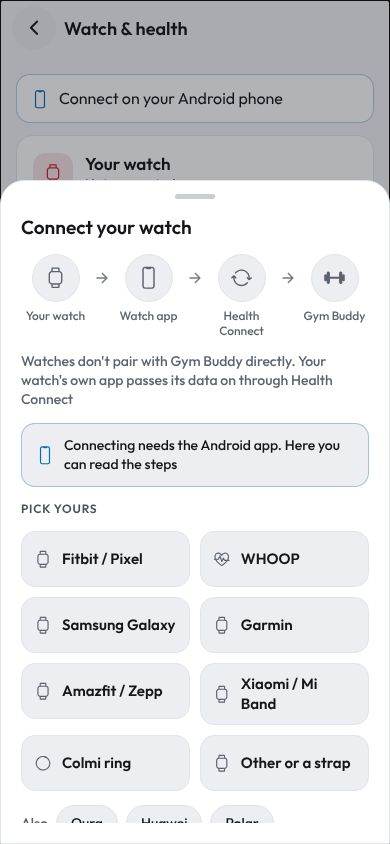
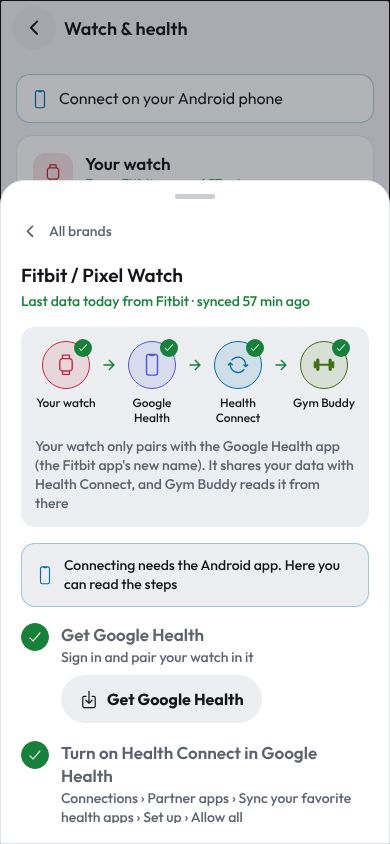
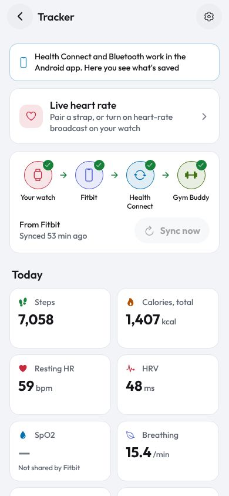

## 12. Checking recovery

Once your watch has shared 4 nights, Today's third ring becomes **Readiness** (0–100). Tap it, or **You › Recovery**,
for what moved it (HRV, resting heart rate, sleep, sleep times), last night's sleep stages, effort for the last 7 days
("Effort 44 / 100") and the 14-day trend. How it is worked out: [Data and sources › Readiness](data-sources.md#readiness).

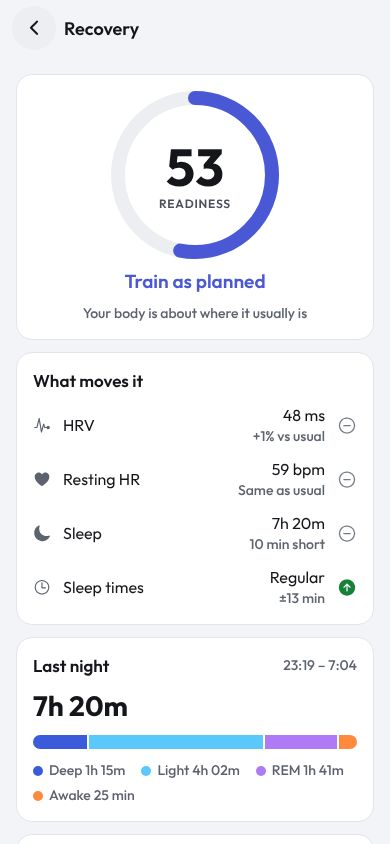
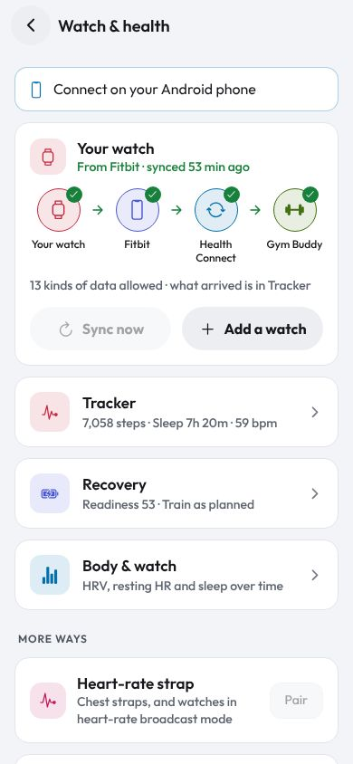

## 13. Changing how it looks

**You › Look and feel › Theme and colours**: System, Light or Dark, and an accent colour (Volt lime, Gold, Ember,
Glacier, Rose). Each part of the day has its own colour everywhere: training teal, heart red, sleep indigo, food orange,
protein pink, water blue, weight purple, streak gold, steps green.

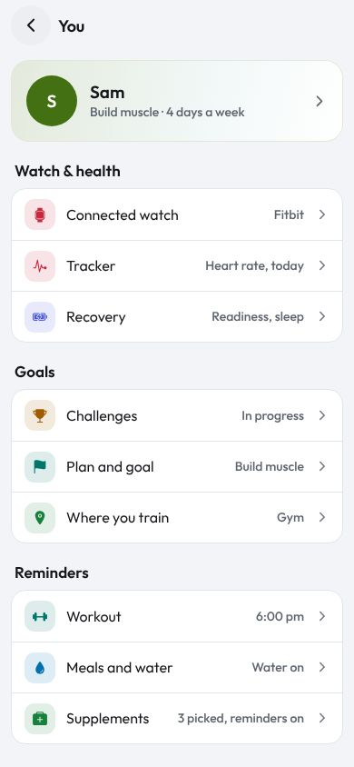
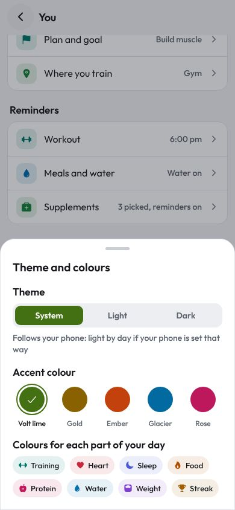
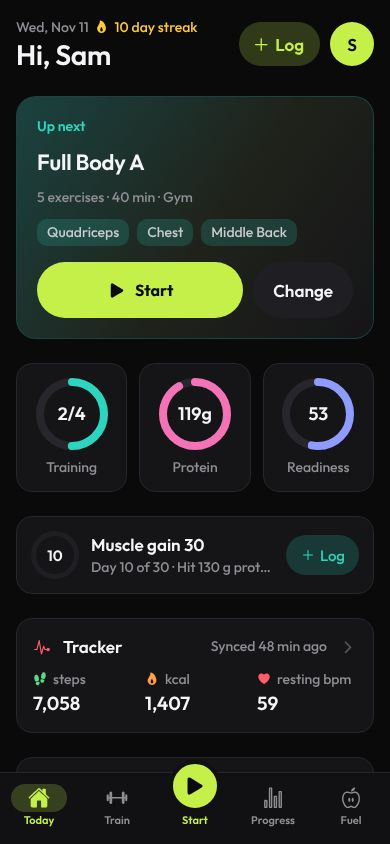
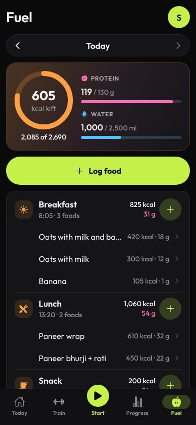

